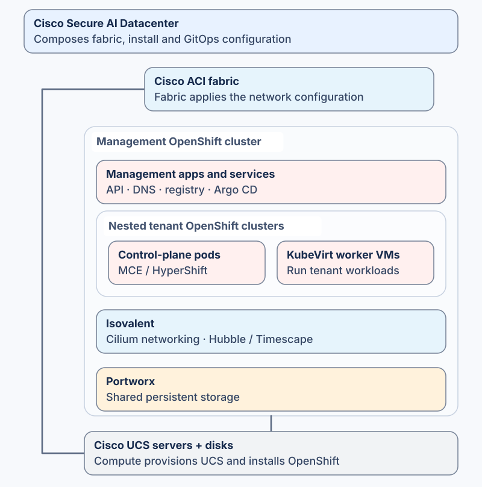
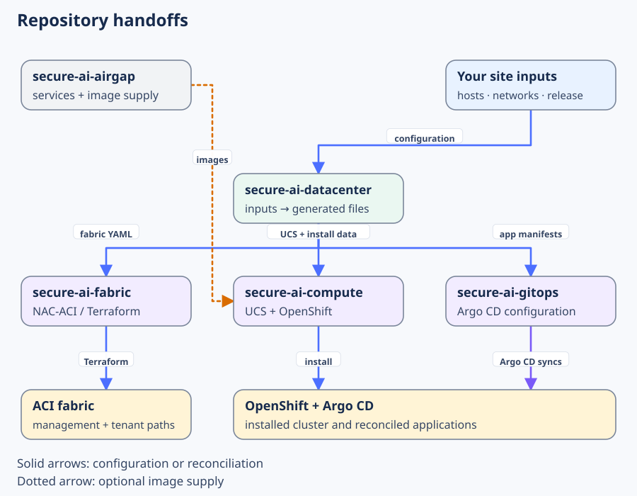

# Cisco Secure AI Datacenter

**Input YAML → validate and render → generated configuration.** This repository is the configuration composer for Cisco Secure AI Datacenter. Shared site inputs describe hardware, networks, software releases and services; the resolver and renderers produce repository-shaped files under [generated/repos/](generated/repos/) for the downstream Fabric, Compute and GitOps repositories.

A composition can describe a standalone bare-metal cluster or **nested Kubernetes (“Kubernetes in Kubernetes”)**: a management OpenShift platform hosts tenant OpenShift control planes as pods and their worker nodes as KubeVirt VMs, alongside Isovalent networking and observability and Portworx storage.

## Technology vendors and projects

The composition brings together the following vendor technologies. Exact versions and enabled capabilities come from [platform-release.yaml](platform-release.yaml), the [add-on catalogue](data/capabilities/addons.yaml) and the selected cluster inputs.

| Vendor | Technology and role |
|---|---|
| **Cisco** | UCS servers, Intersight provisioning, ACI fabric and APIC network automation |
| **Red Hat** | OpenShift Container Platform, OpenShift Virtualization, multicluster engine and OpenShift GitOps; Ansible for service-host configuration |
| **Isovalent (Cisco)** | Isovalent Enterprise Platform: Cilium networking, Hubble/Timescape observability and selected Load Balancer/Egress Gateway integrations |
| **Pure Storage / Portworx** | Distributed persistent storage and CSI volumes, including KubeVirt worker root disks |
| **NVIDIA** | Optional GPU Operator and NIM inference workloads; NVIDIA add-ons are disabled in the current management example |

Upstream building blocks include **HyperShift**, **KubeVirt**, **Argo CD**, **Cilium/Hubble** and the **NAC-ACI module from netascode**. The [integration catalogue](docs/INTEGRATIONS.md) explains their joins; the [repository handoff map](repo-map.yaml) identifies where each generated configuration is consumed.

## Configure and render

### 1. Choose the starting configuration

| Composition | Starting inputs |
|---|---|
| Bare-metal OpenShift with Isovalent CNI | [Minimal three-server example](examples/standalone/) |
| Management OpenShift with storage, virtualization and MCE/HyperShift | [Management cluster](data/clusters/example-management/cluster.yaml) |
| Nested tenant control planes and KubeVirt workers | [Tenant definitions](data/clusters/example-management/hcpclusters/) beneath the management cluster |
| Single-node OpenShift | [SNO cluster](data/clusters/example-sno/cluster.yaml) |

ACI, UCS, image mirroring and the hosted image cache are selected integrations. Supply your site inputs and runtime prerequisites for the chosen configuration.

### 2. Edit the shared inputs

| Input | Controls |
|---|---|
| [Cluster inputs](data/clusters/) | Hosts, management/tenant relationships and enabled capabilities |
| [Network catalogue](data/networks/example-federal.yaml) | VLANs, prefixes, gateways, BGP peers, VIPs and address pools |
| [Shared defaults](data/defaults/example.yaml) | DNS, time, registries, GitOps destinations and common policy |
| [Release selection](platform-release.yaml) | Software versions and exact image/archive references |

The [installation input reference](docs/architectures/INSTALL_INPUT_REFERENCE.md) explains the fields. The [composition model](docs/COMPOSITION_MODEL.md#trace-one-change) traces how inputs combine, including a tenant worker-count change through its parent lifecycle policy.

### 3. Validate, render and review

Prepare the toolchain using [AGENTS.md](AGENTS.md), then follow the [standalone procedure](docs/architectures/COMPACT_BAREMETAL_INSTALL.md) or [integrated renderer sequence](agents/integrated.md). Review the generated files under [generated/repos/](generated/repos/) and verify their [artifact hashes](agents/generated-artifacts.md). [Schemas](schemas/) constrain the inputs; [templates](templates/) define the output shapes.

## Place generated files in downstream repositories

The generated tree already mirrors each destination repository. **Remove the `generated/repos/<repository>/` prefix and keep the rest of the path.** For example, a generated Compute file under `generated/repos/secure-ai-compute/data/openshift/…` goes under `data/openshift/…` in your Compute checkout.

Import the reviewed files into the matching paths and inspect the downstream diff. The [artifact manifest](agents/generated-artifacts.md) defines file ownership and checksums. These pairs show the local output and its downstream example:

| Configuration | Generated locally in this repo | Corresponding downstream example |
|---|---|---|
| ACI management attachments | [platform-management.yml](generated/repos/secure-ai-fabric/data/platform-management/platform-management.yml) | **Fabric:** [data/platform-management/platform-management.yml](https://github.com/mahowlin/secure-ai-fabric/blob/main/data/platform-management/platform-management.yml) |
| ACI tenant routing | [tenant-workloads.yml](generated/repos/secure-ai-fabric/data/tenant-workloads/tenant-workloads.yml) | **Fabric:** [data/tenant-workloads/tenant-workloads.yml](https://github.com/mahowlin/secure-ai-fabric/blob/main/data/tenant-workloads/tenant-workloads.yml) |
| UCS connectivity policies | [lan-connectivity.ezi.yaml](generated/repos/secure-ai-compute/data/ucs/lan-connectivity.ezi.yaml) | **Compute:** [data/ucs/lan-connectivity.ezi.yaml](https://github.com/mahowlin/secure-ai-compute/blob/main/data/ucs/lan-connectivity.ezi.yaml) |
| OpenShift installation | [install-config.yaml](generated/repos/secure-ai-compute/data/openshift/example-management/install-config.yaml) | **Compute:** [data/openshift/example-management/install-config.yaml](https://github.com/mahowlin/secure-ai-compute/blob/main/data/openshift/example-management/install-config.yaml) |
| Server/NIC/disk Agent inputs | [agent-config.yaml](generated/repos/secure-ai-compute/data/openshift/example-management/agent-config.yaml) | **Compute:** [data/openshift/example-management/agent-config.yaml](https://github.com/mahowlin/secure-ai-compute/blob/main/data/openshift/example-management/agent-config.yaml) |
| Selected cluster root | [kustomization.yaml](generated/repos/secure-ai-gitops/clusters/example-management/kustomization.yaml) | **GitOps:** [clusters/example-management/kustomization.yaml](https://github.com/mahowlin/secure-ai-gitops/blob/main/clusters/example-management/kustomization.yaml) |
| Nested tenant definition | [hostedcluster.yaml](generated/repos/secure-ai-gitops/apps/hcp/management/hosted-cluster-lifecycle/overlays/example-management/example-multus-a/hostedcluster.yaml) | **GitOps:** [hosted-cluster-lifecycle example](https://github.com/mahowlin/secure-ai-gitops/blob/main/apps/hcp/management/hosted-cluster-lifecycle/overlays/example-management/example-multus-a/hostedcluster.yaml) |

Regenerate shared configuration from its maintained inputs. Preserve independently maintained downstream code and private runtime files during import.

## Scope and license

The portable standalone example supports static IPv4, three compact hosts and two management NICs with common names. Release compatibility is explicit input; successful rendering does not qualify a new release. The optional community image-mirror operator [requires additional activation and recovery qualification](docs/architectures/MIRROR_OPERATOR.md) and is not required to install OpenShift.

See [LICENSE](LICENSE) for Cisco Sample Code License 1.1. Product software, entitlement and vendor support remain separate from this reference code.
