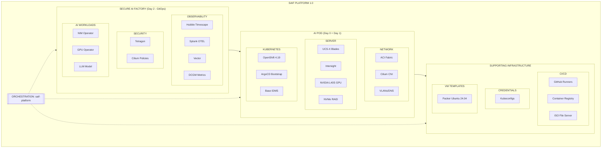
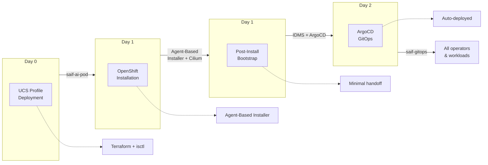
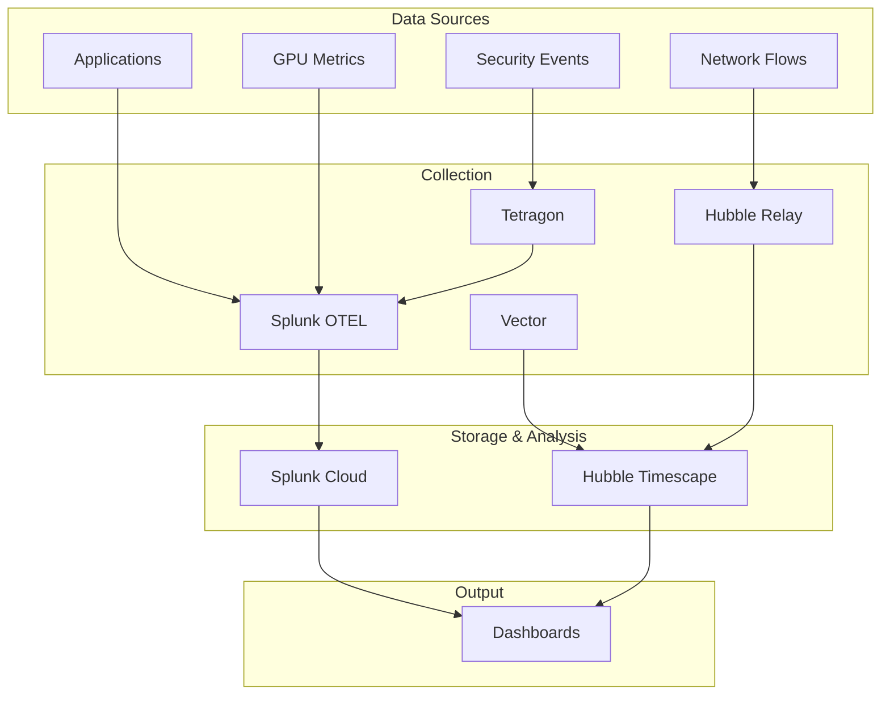
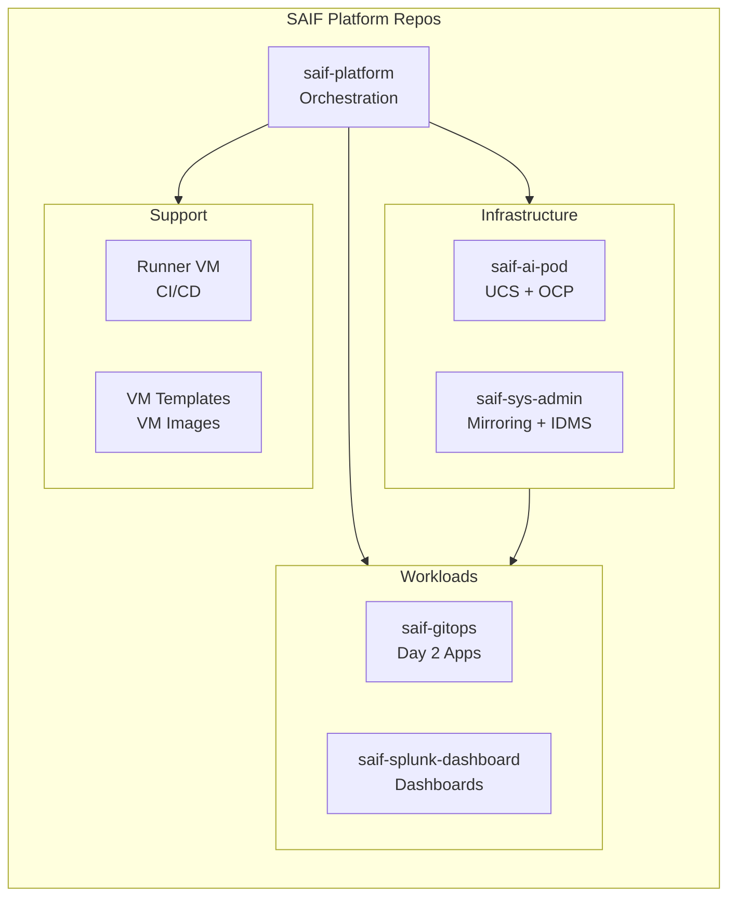

# SAIF Platform Architecture

## Overview

The **Secure AI Factory (SAIF) Platform** is a production-grade, fully automated infrastructure for deploying AI workloads on Cisco UCS hardware with enterprise security and observability.

SAIF Platform 1.0 combines two layers:
- **AI Pod**: Base infrastructure (network, server, Kubernetes)
- **Secure AI Factory**: Security + observability extension

## Platform Diagram

**Layer Repositories:**
- **Secure AI Factory**: saif-gitops, saif-splunk-dashboard
- **AI Pod**: saif-ai-pod, saif-sys-admin
- **Supporting**: Runner VM and VM template repositories (organization-specific)

## Layer Definitions

### AI Pod (Base Infrastructure)

The AI Pod provides GPU-enabled Kubernetes infrastructure. It can exist independently.

| Component | Technology | Purpose |
|-----------|------------|---------|
| Network | ACI Fabric, Cilium CNI | L2/L3 connectivity, pod networking |
| Server | UCS-X, Intersight | Hardware lifecycle, GPU (L40S) |
| Kubernetes | OpenShift 4.19 | Container orchestration |

**Repositories:**
- `saif-ai-pod` - UCS profiles, OpenShift deployment
- `saif-sys-admin` - Image mirroring, IDMS generation

### Secure AI Factory (Extension)

The SAIF layer adds enterprise security and observability on top of AI Pod.

| Component | Technology | Purpose |
|-----------|------------|---------|
| Observability | Hubble Timescape, Splunk, Vector | Flow storage, metrics, dashboards |
| Security | Tetragon, Cilium Network Policies | Runtime enforcement, network segmentation |
| AI Workloads | NIM, GPU Operator | Model inference, GPU scheduling |

**Repositories:**
- `saif-gitops` - All Day 2 operators and workloads
- `saif-splunk-dashboard` - Observability dashboard configuration

### Supporting Infrastructure

| Repository | Purpose |
|------------|---------|
| Runner VM repo | GitHub Actions runners, container registry, ISO server |
| VM template repo | VM image automation for infrastructure |

> **Note:** The post-install workflow pushes kubeconfigs to a separate repository. Configure `KUBECONFIG_REPO_TOKEN` and the kubeconfig repository URL for your environment.

## Deployment Flow

## Data Flow

## Repository Map

## Hardware Inventory

| Cluster | Server Profile | IP | GPU | Purpose |
|---------|---------------|-----|-----|---------|
| ai-pod-1 | saif-ai-pod-1 | 10.0.1.101 | NVIDIA L40S | Primary demo |
| ai-pod-2 | saif-ai-pod-2 | 10.0.1.102 | NVIDIA L40S | AI workloads |
| ai-pod-3 | saif-ai-pod-3 | 10.0.1.103 | None | Workload testing |
| ai-pod-4 | saif-ai-pod-4 | 10.0.1.104 | None | Development |

## Key Integrations

| From | To | Integration |
|------|-----|-------------|
| GitHub Actions | Intersight | UCS profile deployment |
| GitHub Actions | OpenShift | Cluster installation |
| ArgoCD | GitHub | GitOps sync |
| Hubble | ClickHouse | Flow storage (Timescape) |
| Vector | Hubble Timescape | Flow forwarding |
| Splunk OTEL | Splunk Cloud | Metrics/logs |

## Version Information

Current release: **SAIF Platform 1.0**

See [platform-release.yaml](../platform-release.yaml) for complete SBOM including:
- OpenShift 4.19
- Cilium Enterprise 1.18
- NVIDIA GPU Operator v25.10
- Tetragon 1.18
- All operator and image versions

## Related Documentation

- [Repository Map](REPOSITORY_MAP.md) - All repos and their responsibilities
- [Day 0/1/2 Architecture](architecture/DAY0_DAY1_DAY2.md) - Deployment phases
- [AI Pod vs SAIF](architecture/AI_POD_VS_SAIF.md) - Layer distinction
- [saif-ai-pod/docs/TOPOLOGY.md](https://github.com/mahowlin/saif-ai-pod/blob/main/docs/TOPOLOGY.md) - Network topology details
- [saif-gitops/docs/OBSERVABILITY_ARCHITECTURE.md](https://github.com/mahowlin/saif-gitops/blob/main/docs/OBSERVABILITY_ARCHITECTURE.md) - Observability data flow
