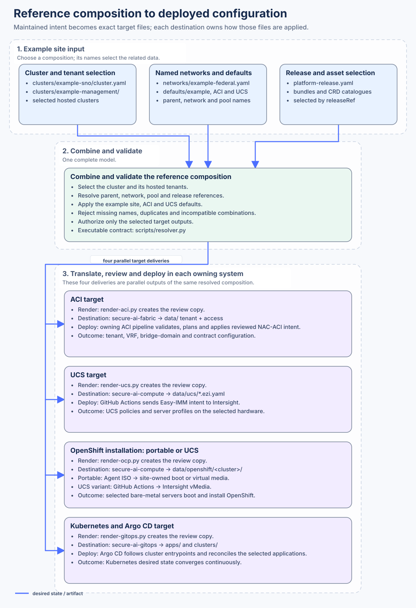
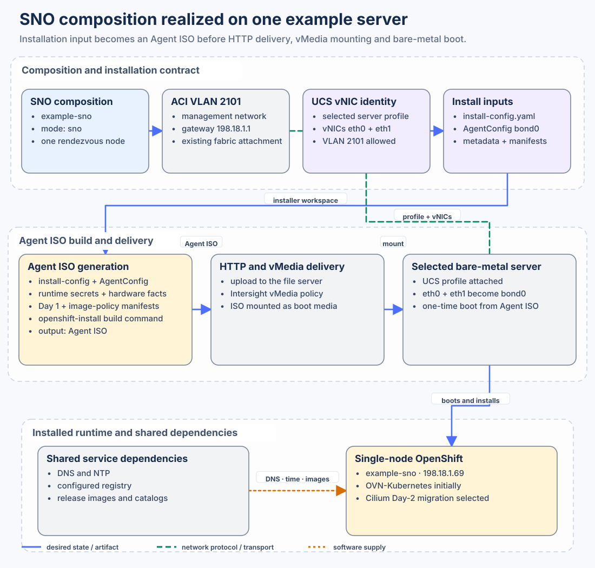
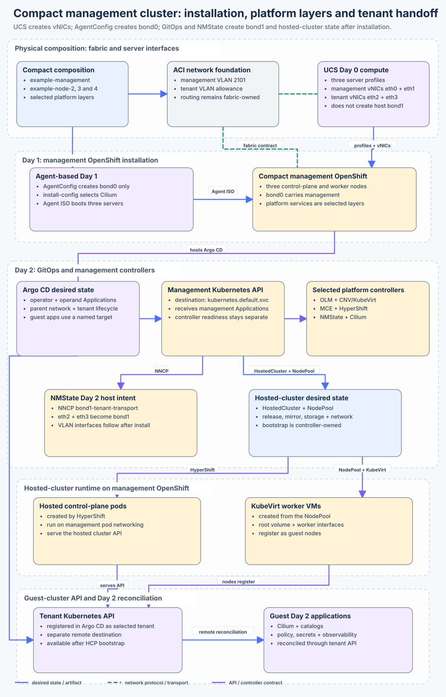
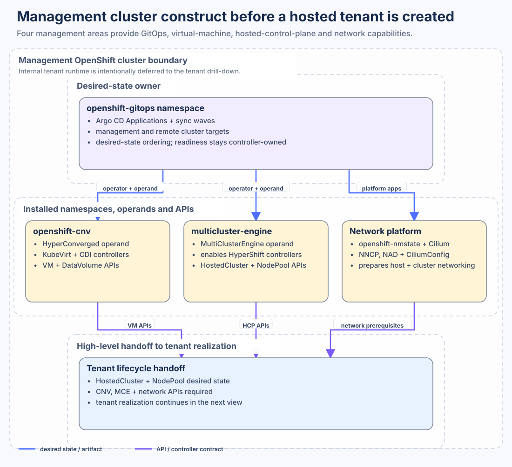
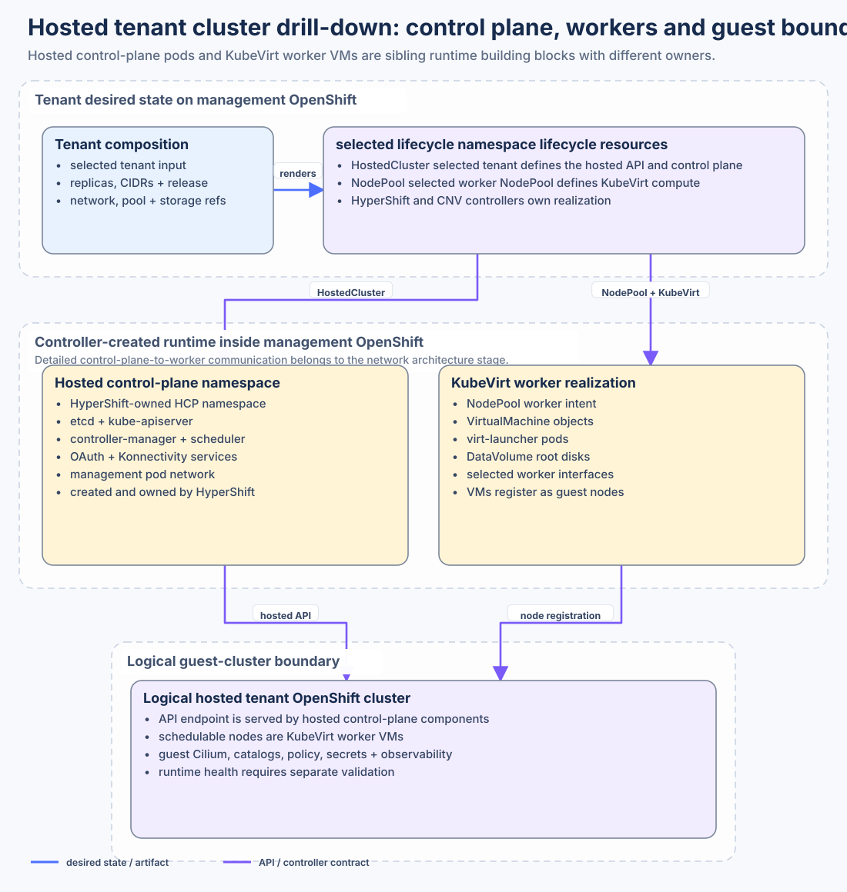

# How one set of inputs becomes a deployment

You start with a few files. A cluster file names the networks, the release and the platform values it wants. The renderer turns that selection into files the destination repositories already know how to apply. Those repositories own the workflows. This one owns the translation.

Open the diagram for its full-size view. The tables and steps below provide the same repository and input relationships in text.

## Start with the example

The cluster file names the composition. It does not repeat every network, release or platform value. It selects those values by name.

| Composition | Maintained input | What it selects |
|---|---|---|
| Single-node OpenShift | [`data/clusters/example-sno/cluster.yaml`](../data/clusters/example-sno/cluster.yaml) | One physical server, SNO mode, management network, release, and UCS identity |
| Compact management cluster | [`data/clusters/example-management/cluster.yaml`](../data/clusters/example-management/cluster.yaml) | Three physical servers, compact OpenShift, HCP capabilities, parent networking, and Day 2 services |
| Hosted tenant | [`example-multus-a.yaml`](../data/clusters/example-management/hcpclusters/example-multus-a.yaml) and [`example-shared.yaml`](../data/clusters/example-management/hcpclusters/example-shared.yaml) | Parent cluster, KubeVirt worker count, cluster/service networks, tenant networks, load-balancer pools, and egress pools |

Those selections lead to the shared input below.

| Selected information | Maintained path | Concrete content |
|---|---|---|
| Network catalogue | [`data/networks/example-federal.yaml`](../data/networks/example-federal.yaml) | VLANs, prefixes, ACI tenant and VRF identity, BGP peers, VIPs, and address pools |
| Platform defaults | [`data/defaults/example.yaml`](../data/defaults/example.yaml) | DNS, NTP, registry mirrors, GitOps repositories, namespaces, images, and sync waves |
| ACI conventions | [`data/defaults/aci.yaml`](../data/defaults/aci.yaml) | Tenant, application-profile, bridge-domain, contract, and protocol defaults |
| UCS conventions | [`data/defaults/ucs.yaml`](../data/defaults/ucs.yaml) | UCS policy names and target conventions |
| Release selection | [`platform-release.yaml`](../platform-release.yaml) | Named OpenShift and Isovalent versions plus pinned image-policy bundles |

## How the input is translated

For a selected composition, [`scripts/resolver.py`](../scripts/resolver.py) and
the four target renderers perform these concrete steps:

1. Select the requested cluster and any hosted tenants beneath it.
2. Follow `parentCluster`, network, pool, and `releaseRef` names to their
   maintained definitions.
3. Apply the platform, ACI and UCS defaults required by that selection.
4. Reject missing names, duplicate ownership, incompatible shapes, and values
   that the selected composition cannot reach.
5. Translate the complete result into the native file shapes used by ACI, UCS,
   OpenShift installation, and Kubernetes GitOps.
6. Write repository-shaped review copies under [`generated/repos/`](../generated/repos/)
   without contacting or changing a target system.

The four translation entry points are
[`render-aci.py`](../scripts/render-aci.py),
[`render-ucs.py`](../scripts/render-ucs.py),
[`render-ocp.py`](../scripts/render-ocp.py), and
[`render-gitops.py`](../scripts/render-gitops.py). A value being present in a
catalogue is not enough to produce output; the selected composition must reach
and authorize it.

## Exact target paths and execution

The generated tree mirrors each destination. Delivery removes only the
`generated/repos/<repository>/` prefix and preserves the remaining path.

### ACI fabric

The selected profile also emits [management attachment YAML](../generated/repos/secure-ai-fabric/data/platform-management/platform-management.yml). [Fabric and host network handoff](architectures/FABRIC_NETWORK.md) joins its BD/EPG/ports to the installer management bond and distinguishes tenant BGP.

- Review copy:
  [`generated/repos/secure-ai-fabric/data/tenant-workloads/tenant-workloads.yml`](../generated/repos/secure-ai-fabric/data/tenant-workloads/tenant-workloads.yml)
  and [`access-policies.yml`](../generated/repos/secure-ai-fabric/data/tenant-workloads/access-policies.yml).
- Destination: `secure-ai-fabric`, at `data/tenant-workloads/tenant-workloads.yml` and
  `data/tenant-workloads/access-policies.yml`.
- Execution: `secure-ai-fabric` validates the tenant and access policy, then applies it to ACI.
- Result: tenant, VRF, bridge domain, contract, access policy and the related fabric configuration.

### UCS and Intersight

- Review copy:
  [`generated/repos/secure-ai-compute/data/ucs/lan-connectivity.ezi.yaml`](../generated/repos/secure-ai-compute/data/ucs/lan-connectivity.ezi.yaml)
  and the adjacent `.ezi.yaml` policy overlays.
- Destination: `secure-ai-compute`, preserving `data/ucs/*.ezi.yaml`.
- Execution: `secure-ai-compute` validates the Easy IMM policy and server-profile input and deploys it through Cisco Intersight.
- Result: UCS network, server, and profile configuration assigned to the target
  hardware.

### OpenShift bare-metal installation

- Review copy:
  [`generated/repos/secure-ai-compute/data/openshift/example-management/install-config.yaml`](../generated/repos/secure-ai-compute/data/openshift/example-management/install-config.yaml)
  and [`agent-config.yaml`](../generated/repos/secure-ai-compute/data/openshift/example-management/agent-config.yaml).
- Destination: `secure-ai-compute`, preserving
  `data/openshift/<cluster>/*.yaml`.
- Execution: `secure-ai-compute` builds an Agent ISO from the install and agent config, serves that ISO over HTTP, and boots the selected servers from it through Intersight virtual media.
- Result: the selected SNO or compact OpenShift cluster installed on its UCS
  servers.

### Kubernetes and Argo CD

- Review copies include the management image policy at
  [`clusters/_base/tier1-core/platform-idms.yaml`](../generated/repos/secure-ai-gitops/clusters/_base/tier1-core/platform-idms.yaml)
  and the hosted cluster lifecycle objects
  [`hostedcluster.yaml`](../generated/repos/secure-ai-gitops/apps/hcp/management/hosted-cluster-lifecycle/overlays/example-management/example-multus-a/hostedcluster.yaml)
  and [`nodepool-workers.yaml`](../generated/repos/secure-ai-gitops/apps/hcp/management/hosted-cluster-lifecycle/overlays/example-management/example-multus-a/nodepool-workers.yaml).
- Destination: `secure-ai-gitops`, preserving each relative `apps/`
  and `clusters/` path at the repository root.
- Execution: Argo CD reads `secure-ai-gitops` and reconciles the objects. A sync workflow can ask for a refresh. Argo CD is the reconciler.
- Result: management-cluster services, hosted-control-plane objects, tenant
  worker definitions, and guest-cluster services selected by the composition.

[`repo-map.yaml`](../repo-map.yaml) is the machine-readable handoff contract.
This repository owns deterministic translation and review artifacts. Each
destination owns transport acceptance, credentials, provider state, execution,
reconciliation, and runtime health.

## Trace one change

Suppose `example-multus-a` needs three worker virtual machines. In the selected `workers` phase the parent lifecycle settings take precedence over the tenant's ordinary `spec.nodePool.replicas`.

1. Change `spec.day2GitOps.hostedClusterLifecycle.workerReplicasByCluster.example-multus-a` in [`example-management/cluster.yaml`](../data/clusters/example-management/cluster.yaml) to `3`. This explicit per-cluster override wins over the parent `workerReplicas` fallback and the tenant's NodePool count. Add `3` to the tenant `spec.nodePool.stagedRollout.checkpoints` (currently `[0, 1, 5]`), retaining its bounds and other accepted checkpoints. The validator rejects an override outside that policy. Editing only the tenant count does not change this selected output while the parent override remains.

2. The resolver follows `parentCluster`, the named networks and pools, the platform defaults,
   and the release inherited from `example-management`.
3. `render-gitops.py` writes the review copy at
   [`generated/.../example-multus-a/nodepool-workers.yaml`](../generated/repos/secure-ai-gitops/apps/hcp/management/hosted-cluster-lifecycle/overlays/example-management/example-multus-a/nodepool-workers.yaml).
4. Delivery keeps the path
   `apps/hcp/management/hosted-cluster-lifecycle/overlays/example-management/example-multus-a/nodepool-workers.yaml`
   in `secure-ai-gitops`.
5. Argo CD reconciles the `NodePool`. HyperShift and KubeVirt then create the worker virtual machines.

Matching input and generated values proves translation. It does not prove that
delivery, Argo CD convergence, or worker health succeeded; those require their
own evidence.

## Lifecycle boundary

A change crosses six distinct gates:

1. the example inputs;
2. reference and contract validation;
3. deterministic target translation;
4. target-repository transport and review;
5. target-owned apply or reconciliation;
6. runtime and behavioral evidence.

A runtime patch is not canonical input, and a generated review copy is not a
place to preserve a manual fix.

## Composition architectures

The example can describe a single-node cluster, a compact management cluster, and hosted clusters. These views show the shape of each one. Cross-system handoffs belong in the [integration catalogue](INTEGRATIONS.md). What to observe is in the [validation notes](validations/README.md).

### Single-node OpenShift

[`data/clusters/example-sno/cluster.yaml`](../data/clusters/example-sno/cluster.yaml)
selects one UCS server and the existing ACI management network. The contracts
line up explicitly:

- ACI supplies management VLAN 2101;
- the UCS profile presents `eth0` and `eth1` with that VLAN;
- the rendered `agent-config.yaml` joins those interfaces as `bond0`;
- the target workflow combines `install-config.yaml`, `agent-config.yaml`,
  selected Day-1 and image-policy manifests, and runtime-enriched secret and
  hardware facts before running `openshift-install agent create image`;
- the resulting Agent ISO is served over HTTP, mounted through Intersight virtual media, and used to boot the selected server once; and
- DNS, NTP and mirrored images stay separate service dependencies.

The workflow and diagram distinguish **ISO inputs** from **ISO delivery**. The
composition repository renders reviewable installation files. The target
`secure-ai-compute` owns ISO generation, upload, virtual-media attachment and server boot. Secrets and discovered hardware facts are supplied there, not in this tree.

The installed node initially uses OVN-Kubernetes and selects a separate Cilium
Day-2 migration. Generated installation data belongs in
`secure-ai-compute:data/openshift/<cluster>/`; that repository owns deployment.

### Compact management cluster

[`data/clusters/example-management/cluster.yaml`](../data/clusters/example-management/cluster.yaml)
composes `example-node-2`, `example-node-3`, and `example-node-4` into a three-node compact
OpenShift cluster. The lifecycle split matters:

- **Day 0 UCS:** Intersight creates three server profiles with management vNICs
  `eth0`/`eth1` and the optional tenant vNIC pair `eth2`/`eth3`. UCS permits the
  selected VLANs; it does not create an operating-system bond.
- **Day 1 OpenShift:** AgentConfig creates only management `bond0` from
  `eth0`/`eth1`, and the Agent ISO installs the compact cluster.
- **Day 2 management GitOps:** Argo CD reconciles management Applications to
  `https://kubernetes.default.svc`. The NMState
  `bond1-tenant-transport` NNCP joins the host-side interfaces `eth2` and
  `eth3` as `bond1`, then creates the selected VLAN interfaces after install.
- **Hosted-cluster bootstrap:** management-local `HostedCluster` and `NodePool`
  desired state is reconciled through the management Kubernetes API.
  HyperShift and the KubeVirt provider own the resulting control-plane and
  worker bootstrap.
- **Guest Day 2:** after HyperShift's tenant API is registered with Argo CD,
  guest Applications use the hosted cluster's API rather than the management API.

OpenShift is the underlay. OpenShift Virtualization, MCE/HyperShift, NMState,
Cilium and the hosted-cluster Applications are selected layers on that
underlay, not inherent properties of every compact cluster. The exact local
and remote API handoffs are shown in
[Hosted-cluster lifecycle](INTEGRATIONS.md#hosted-cluster-lifecycle).

### Management cluster construct

This view is what sits inside management OpenShift before a hosted cluster exists. It stops at the handoff into that cluster:

1. `openshift-gitops` contains Argo CD Applications and their sync ordering.
2. `openshift-cnv` contains the `HyperConverged` operand, KubeVirt/CDI
   controllers, and VM/DataVolume APIs.
3. `multicluster-engine` contains the `MultiClusterEngine` operand, enables the
   HyperShift controllers, and exposes `HostedCluster`/`NodePool` APIs.
4. the network platform combines `openshift-nmstate` and Cilium resources that
   prepare host and cluster networking.
5. once installed, those APIs and controllers can accept the tenant lifecycle
   desired state shown in the next view.

The diagram does not repeat tenant control-plane pods, worker VMs or guest
services. Those are the subject of the tenant drill-down below.

### Hosted tenant cluster drill-down

[`example-multus-a.yaml`](../data/clusters/example-management/hcpclusters/example-multus-a.yaml)
renders a `HostedCluster` and `NodePool` in `clusters-example-multus-a`. Those two
resources lead to sibling runtime building blocks inside management OpenShift:

- HyperShift creates a dedicated hosted-control-plane namespace. Representative
  components include etcd, kube-apiserver, controller-manager, scheduler,
  OAuth and Konnectivity services, all on management pod networking.
- the KubeVirt provider creates `VirtualMachine` objects, `virt-launcher` pods,
  DataVolume-backed root disks and the selected worker interfaces from the
  `NodePool`.

The hosted API and registered KubeVirt worker VMs together form the logical
guest OpenShift cluster. Guest Cilium, catalogs, policy, secrets and
observability are reconciled through that guest API. Detailed communication
between the hosted control plane and workers is documented with each selected
tenant networking architecture:

- [Multus, DHCP and direct BGP](architectures/HCP_MULTUS_DHCP.md).

Each hosted cluster selects one `workerNetworkProfileRef`. That profile gives the worker one extra interface, one Multus attachment, and one DHCP service. The lease from that service is what sets the address, the default route and DNS. The cluster file names the network in `workerNetworks`. In this example that name is `tenant-b-workers`.

- `multus-l2-dhcp` places the worker and the DHCP service on the same NetworkAttachmentDefinition, the object that names the bridge. The VLAN, the bridge and the ACI tenant come from the network catalogue. DHCP only serves addresses on the attachment it was given.

Peering is not part of the logical worker-network identity. Direct worker BGP,
ILB, L2 announcement, or an east/west-only network are separate service-edge
and route-delivery choices. A Multus L2 attachment does not imply peering.

The DHCP service can have one isolated endpoint and lease scope per logical
network; that service plumbing does not add worker NICs.

External registry, DNS, object-storage and tenant-fabric services remain
separately owned dependencies. Tenant users do not acquire ACI route-policy,
VLAN, BGP-peer, load-balancer-pool or egress-pool ownership.
