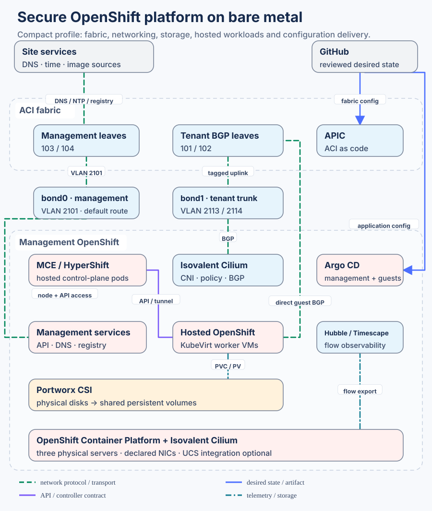
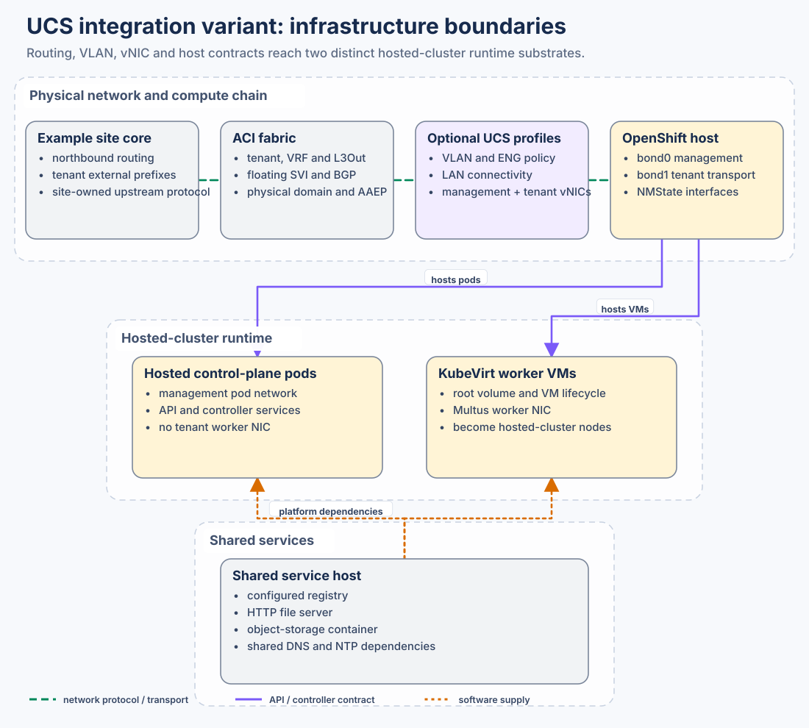
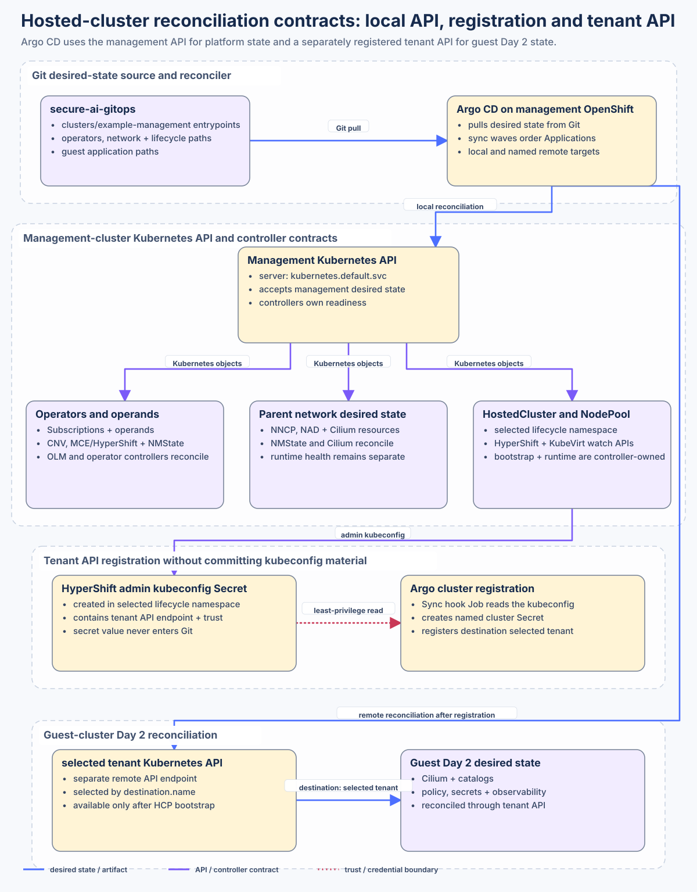
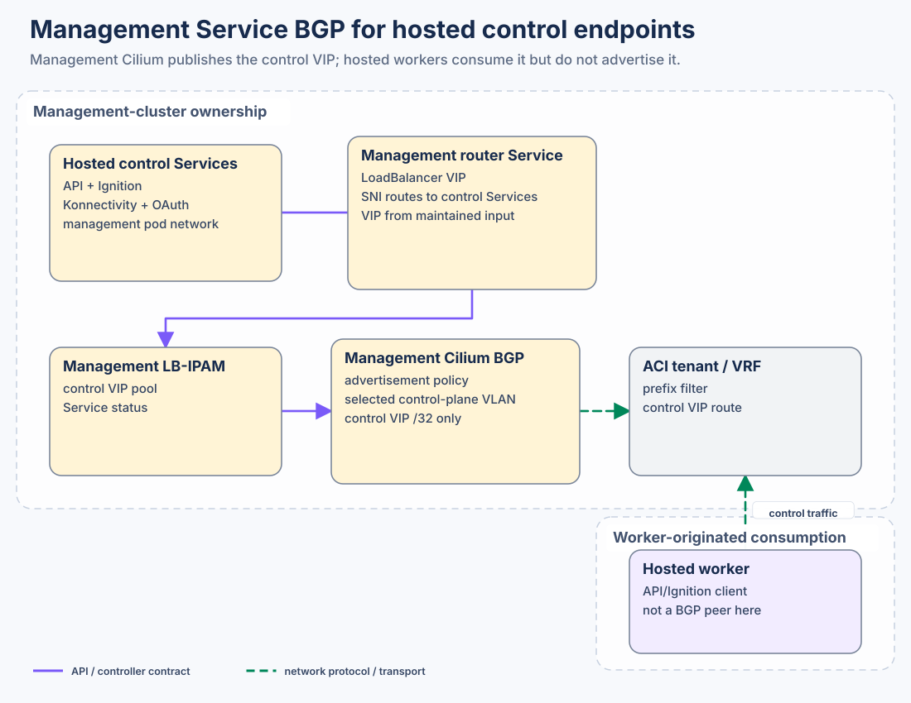
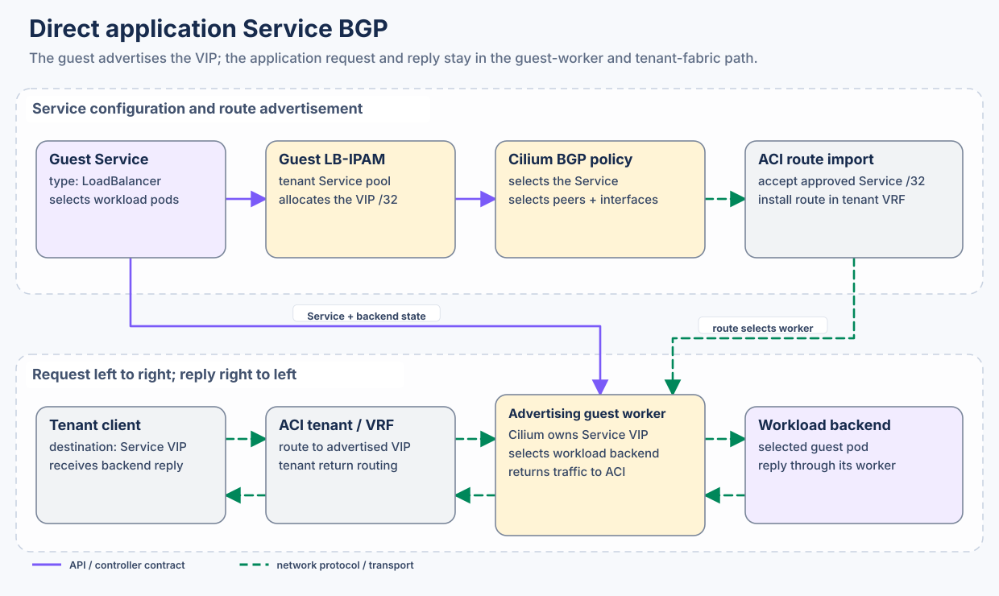
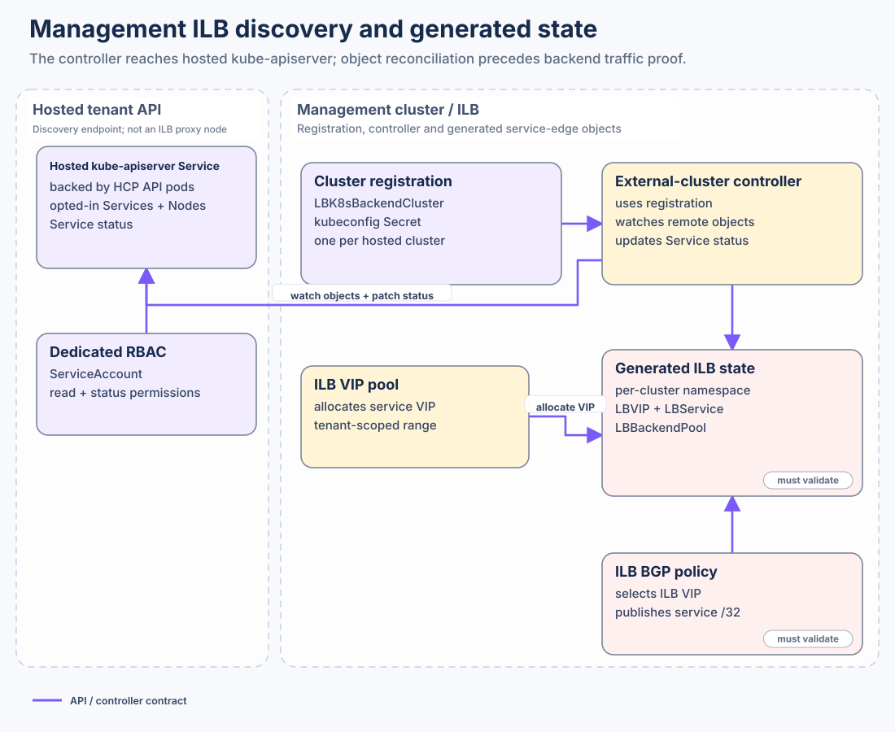
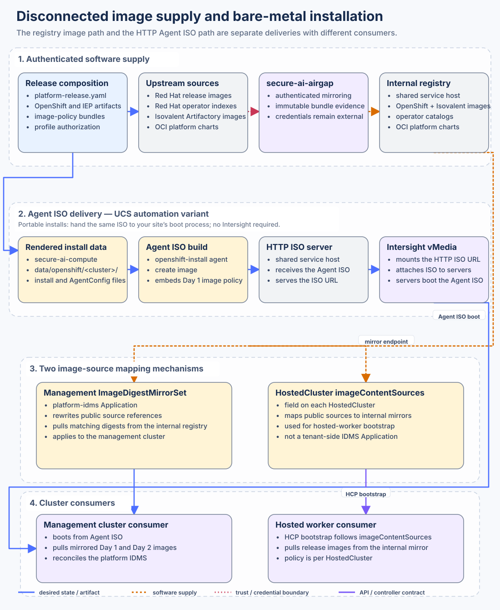
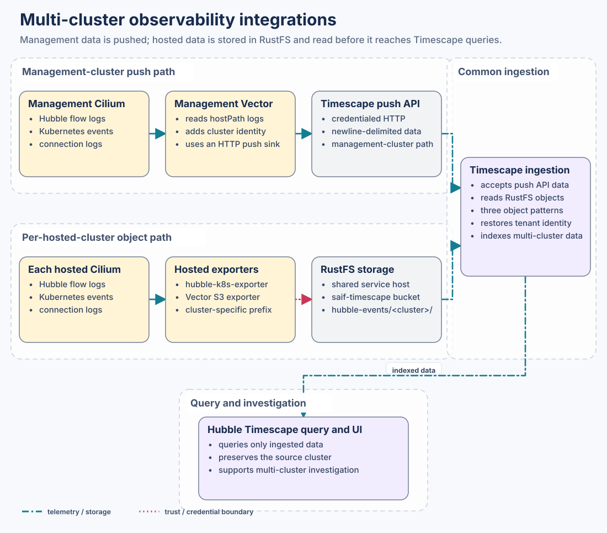

# Integration catalogue

A composition is worth reading when you can see the join between systems that different people own. An integration here is that join: a named network, a VLAN trunk, a Kubernetes API, an artifact, a repository handoff, a trust boundary, or a telemetry and storage interface. A line on a diagram is not enough.

This page keeps those cross-system contracts. [The composition model](COMPOSITION_MODEL.md) keeps the inputs, the translation, the fan-out into destination repositories, the cluster shapes, the namespaces and the building blocks. If that page already explains a shape, this one links to it.

The examples come from maintained input, the resolver and renderer boundaries, the target-repository map, the generated Argo CD inventory, and the validation notes. Coverage here does not mean every drawn component is live.

## Read the truth boundary first

| Label used here | Meaning |
|---|---|
| Maintained input | An operator-owned value in `data/` or the release catalogue |
| Generated desired state | A deterministic target-shaped artifact exists; it may not have been transported or reconciled |
| Target/runtime owner | Another repository, controller or service owns execution and health |
| Planned or must validate | The contract is being designed or tested and must not be described as deployed |
| Optional or off | The composition knows the integration, and this example does not enable it |

Diagrams open at full size. On narrow screens, use the adjacent object and ownership tables to follow the same relationships without relying on colour or small diagram labels.

## Platform integration reference

This detailed view answers **which runtime and configuration contracts join the selected compact platform?** Start with the [system overview](../README.md) for its major parts. Here, management control-plane pods remain distinct from hosted worker VMs, and fabric, image, storage and configuration dependencies are expanded.

## Trace the selected compact platform

Start with [fabric and host network handoff](architectures/FABRIC_NETWORK.md). The chosen path configures direct-attached active-backup server links; an optional UCS/FI deployment needs its own reviewed uplink attachment inputs. Do not apply both physical layouts indiscriminately.

| Component / relationship | Maintained owner | Artifact and applying system | Verification boundary |
|---|---|---|---|
| Management attachment and tenant BGP | network catalog + cluster interface selections | Fabric NAC YAML; installer AgentConfig; GitOps NNCP/BGP/NAD | Cross-target gateway/VLAN/port/ASN joins, declared-input variation, Terraform validation; live link/peer state is separate |
| Bare-metal OpenShift + Isovalent CNI | cluster input + platform-release.yaml | Compute Agent ISO + official CLife manifests | Raw hashes, private staging contract, then actual node/operator readiness |
| Portworx CSI and worker root volumes | cluster.day2GitOps.storage | GitOps storage objects and NodePool rootVolume/PVC references | Declared storage class/PV consumption; actual disk identity, licensing and provider cutover remain installation prerequisites |
| MCE / HyperShift / Virtualization | selected management and HCP inputs | GitOps operator Subscriptions, HostedCluster/NodePool and KubeVirt workers | Operator/API readiness and hosted bootstrap; a local parent build does not qualify running guests |
| Cilium policy, BGP and guest service exposure | selected network/pool/feature references | management and guest Cilium objects in GitOps | Resource/prefix ownership; observed routes and traffic need runtime verification |
| Hubble / Timescape | observability defaults and selected profiles | exporters, object-store references and Timescape Applications | Generated identity/export path; real ingestion/UI availability is separate |
| Registry and image delivery | shared release/registry inputs; Airgap producer | mirror receipts, registry hosting and selected guest mirror mappings | [Three-stage chain](architectures/REGISTRY_CHAIN.md); optional operator activation/recovery stays bounded |
| DNS, time, site edge, state and entitlement | declared endpoint/reference plus site owner | installer/runtime references; existing site services/L3Out/contract | Must exist before use; these external services and fabric commissioning are not provisioned by a cluster render |
| Continuous configuration | defaults.gitops and selected roots | GitOps bases/charts and Argo CD destinations | Reviewed repo/ref/root and runtime Secret refs, then sync/health |

The site-edge row is an explicit integration boundary: this candidate manages the cluster-facing attachment, not an unspecified upstream routing protocol or the physical commissioning of APIC/servers. Complete deployment requires those named external owners and actual private inputs; rendering alone is not an end-to-end operational result.

## Infrastructure foundation

The picture shows the optional UCS variant. The selected direct-attached example uses the [management and tenant attachment contract](architectures/FABRIC_NETWORK.md); do not apply UCS/FI wiring assumptions to it. It is not another rendering-flow view. The
network catalogue binds ACI tenant/routing identity to VLANs. UCS turns selected
VLANs into Ethernet Network Group and vNIC policy. After OpenShift installation,
NMState turns the actual host interfaces into the selected bonds, VLAN
subinterfaces and bridges. Management OpenShift then hosts two different
consumers: HyperShift control-plane pods on its pod network and KubeVirt worker
VMs with the worker attachment selected by the composition.

Concrete current examples:

- [`example-federal.yaml`](../data/networks/example-federal.yaml) owns ACI
  physical-domain/AAEP references, BGP identities, floating SVIs, tenant VRFs,
  VLANs and pools. Optional endpoint/OSPF transit fragments are separate examples.
- [`example-management/cluster.yaml`](../data/clusters/example-management/cluster.yaml)
  separately selects the UCS tenant vNIC pair `eth2`/`eth3` and the Day-2
  host-side `eth2`/`eth3` -> `bond1` NMState intent.
- [`render-aci.py`](../scripts/render-aci.py), [`render-ucs.py`](../scripts/render-ucs.py)
  and the [management GitOps renderer](../scripts/gitops_renderer/management.py)
  turn the same resolved networks into their respective owner-native objects.
- the internal registry, the HTTP file server and the object store are containers on a shared service host. DNS and NTP are additional shared dependencies.
  Their maintained endpoints are owned in
  [`data/defaults/example.yaml`](../data/defaults/example.yaml).

The important design property is continuity: ACI VLAN identity, UCS allowance,
host VLAN identity and VM attachment must describe the same network. Successful
generation proves that translation, not link state or routing adjacency.

## Hosted-cluster lifecycle

Each class of GitOps desired state has an API, and a controller owns the next step. The picture links to the
[management construct and tenant drill-down](COMPOSITION_MODEL.md#management-cluster-construct)
for internal namespaces, pods, services and VMs instead of repeating them.

The current reconciliation contract is:

1. Argo CD reads `clusters/example-management` entrypoints from
   `secure-ai-gitops`.
2. Management Applications use
   `destination.server: https://kubernetes.default.svc`. Through the management
   Kubernetes API they create operator/operand desired state, parent-network
   resources, and `HostedCluster`/`NodePool` resources.
3. OLM and the installed CNV, MCE/HyperShift, NMState and Cilium controllers
   watch those APIs and own runtime reconciliation. An accepted Kubernetes
   object or successful sync is not proof that its controller is Ready.
4. HyperShift creates `<tenant>-admin-kubeconfig` in the tenant lifecycle
   namespace. A least-privilege Sync hook Job (in the selected workers phase) reads that Secret and creates an
   Argo CD cluster Secret named for `example-multus-a`; kubeconfig material is not
   committed to Git.
5. Guest Applications use `destination.name: example-multus-a`, so Cilium, catalogs,
   policy, secrets and observability are reconciled through the tenant
   Kubernetes API, not the management API.

Hosted-cluster bootstrap is therefore different from guest Day 2. The
management API accepts `HostedCluster`, `NodePool`, release, mirror, storage and
network desired state; HyperShift and KubeVirt produce the API and workers.
Only after registration can Argo CD address the guest API. These arrows are
desired-state, trust and API contracts—not workload traffic paths.

[`scripts/gitops_renderer/orchestrator.py`](../scripts/gitops_renderer/orchestrator.py)
is the executable inventory of renderer families.
[`applications.py`](../scripts/gitops_renderer/applications.py) owns local and
remote Application destinations, while
[`hosted_clusters.py`](../scripts/gitops_renderer/hosted_clusters.py) owns the
kubeconfig-to-Argo registration Job. Argo sync waves in
[`data/defaults/example.yaml`](../data/defaults/example.yaml) express ordering;
they do not substitute for readiness checks.

Storage is topology-selected rather than part of the all-cluster base. SNO
uses a GitOps-delivered mdadm RAID10 MachineConfig, an MCP/systemd/array health
gate, then the retained finalizer-bearing LVMS provider Application. Host
readiness and provider resources remain under that one Application identity,
whose source path is updated in place. The compact HCP-management topology
retains that provider only until its gated consumer
and disk cutover, while staging Portworx
local PX-StoreV2 with stable per-node device ownership and internal KVDB.
The selected lifecycle phase is `workers`: the automated hosted-cluster Application includes NodePools with five `example-multus-a` workers and three `example-shared` workers, using RWX Block roots. Importing/syncing that root can create workers once private enrichment and controller/storage prerequisites are satisfied. The Portworx Application is present but manual; its activation must precede usable worker disks. Rendering or root synchronization alone proves neither storage readiness nor guest health. AI Pod owns installation/bootstrap and hardware enrichment, not storage
reconciliation. See [the bounded storage evidence page](validations/portworx-shared-storage.md).

## Tenant networking and isolation

Tenant networking in this example is the Multus L2 attachment. This catalogue
records the cross-system contracts and links to the owning guide.

| Architecture | Worker and DHCP attachment | Advertised service edge | Ingress and return owner | Detailed owner |
|---|---|---|---|---|
| Multus L2 bridge + KubeVirt DHCP service | The worker and the DHCP virtual machine both use the NetworkAttachmentDefinition the management cluster rendered. DHCP does not choose the VLAN or the bridge | Chosen separately: direct BGP, Isovalent Load Balancer, L2 announcement, or no external edge | Whichever edge you selected owns ingress and the return path. The VLAN attachment by itself does not | [HCP with Multus, DHCP and direct BGP](architectures/HCP_MULTUS_DHCP.md) |

`example-multus-a` names its worker network `tenant-b-workers` in `networking.workerNetworks`. The `multus-l2-dhcp` profile turns that name into the Multus attachment. BGP and service advertisement are separate choices. They are not implied by the network name.

The compact management cluster's Cilium BGP path publishes hosted API,
Ignition, Konnectivity and OAuth through the management service edge. That is
separate from guest-worker Service BGP and from the planned ILB and EGW edges.

Tenant intent selects a named pool; platform intent owns the addresses, ACI
tenant/VRF/L3Out, peer ASNs, prefix filters, maximum prefixes and route-import
boundary. That separation lets a tenant consume Kubernetes Services and egress
policy without acquiring arbitrary fabric authority.

Generated LB-IPAM or egress-pool desired state is not runtime proof of route
advertisement, backend delivery, SNAT or return. External Isovalent Load
Balancer registration remains a separate validation path against the selected
official release. Exact evidence belongs to the
[validation notes](validations/README.md), not to this catalogue.

## Disconnected software delivery

Approved releases and component images have to reach a disconnected cluster, and the bare-metal installer has to reach the server. The registry and Agent ISO are related but distinct delivery paths:

- This repository selects immutable OpenShift/IEP artifacts and image-policy
  bundle identities.
- `secure-ai-airgap` owns authenticated mirror workflows, internal registry
  custody, IDMS/bundle evidence and credential handling.
- the internal registry holds the mirrored Red Hat release and operator content, the Isovalent images, and the platform charts selected by the release.
- `secure-ai-compute` workflow `.github/workflows/openshift-deploy.yaml`
  consumes the rendered `data/openshift/<cluster>/` input, builds an Agent ISO with
  `openshift-install agent create image`, uploads it to the HTTP file server
  selected by `OCP_ISO_SERVER_URL`, and mounts that URL through Intersight
  vMedia. The ISO is served by HTTP; it is not pulled from the container
  registry.
- During installation, the management cluster pulls its release and embedded
  Day 1 content from the internal registry using the rendered image policy.
- For management Day 2, `secure-ai-gitops` reconciles the
  `platform-idms` Application at exact target path
  `clusters/_base/tier1-core/platform-idms.yaml` plus catalogs and platform apps.
- Hosted clusters do not receive a tenant-side IDMS Application. The renderer
  writes mirror policy into each exact target
  `apps/hcp/management/hosted-cluster-lifecycle/overlays/<parent>/<tenant>/hostedcluster.yaml`
  as `HostedCluster.spec.imageContentSources`, which HCP uses for worker
  air-gap bootstrap.

An `ImageDigestMirrorSet` is an image-source rewrite rule: a pull that names a
configured public source is redirected to the matching digest in the internal
registry. It is not a forward proxy. Management OpenShift receives that object
through the platform-IDMS Application. Hosted workers instead receive
`HostedCluster.spec.imageContentSources`; no tenant-side IDMS Application is
rendered.

[`repo-map.yaml`](../repo-map.yaml) records those repository handoffs.
[`data/defaults/example.yaml`](../data/defaults/example.yaml) records the internal
registry, mirrors, catalog aliases, platform-IDMS chart and hosted-cluster image
content sources consumed by rendering. [`render-ocp.py`](../scripts/render-ocp.py)
owns the reviewable installation files; [`core.py`](../scripts/gitops_renderer/core.py)
owns management platform IDMS; and
[`hosted_clusters.py`](../scripts/gitops_renderer/hosted_clusters.py) owns the
hosted-cluster field. A valid reference does not prove that an image was
mirrored, the ISO was mounted, or every consuming cluster can pull it; target
workflow and runtime evidence own those claims.

Credentials are integrations too, but their values do not belong in this
repository. Artifactory, Vault, registry, Argo repository and sealed-secret
credentials cross explicitly owned trust boundaries and must remain redacted.

## Multi-cluster observability

Timescape has to keep the source cluster when events come from the management cluster and from more than one hosted cluster. The current renderer contains two integration paths:

- The management cluster's Vector agent reads Hubble/connection log files,
  adds the cluster name and sends newline-delimited data to the Timescape push
  API.
- Each hosted cluster receives a Hubble Kubernetes exporter and a Vector S3
  exporter. The exporter writes a prefix that includes the cluster name into the object store named in the defaults.
- The generated `hubble-timescape` Application configures its ingestion layer
  with that bucket URI, three object patterns, and each prefix-to-cluster
  mapping. Timescape therefore ingests the stored hosted-cluster objects before
  they appear in its query/UI layer; `overrideClusterName` restores the tenant
  identity.

The maintained endpoints, bucket and images are in
[`data/defaults/example.yaml`](../data/defaults/example.yaml). The [declared Timescape base](../data/gitops/hcp-base/tier2-isovalent/hubble-timescape.yaml) owns the selected auth method, gRPC choice and Secret references; these must agree with the bundled chart and metadata-only secret manifest. The executable
translation is in
[`tenant_observability.py`](../scripts/gitops_renderer/tenant_observability.py)
and [`applications.py`](../scripts/gitops_renderer/applications.py). Static
parity can prove that each tenant receives the expected applications, object
prefixes, and Timescape bucket configuration. It cannot prove collection
completeness, authentication, retry behavior, object ingestion, or a correct
multi-cluster query.

Splunk and Intersight are optional switches, and this example leaves them off.

The current `preceding-registry` selection supplies hosted Vector from the declared site registry (`registry.example.com:5000/isovalent/vector:0.51.0-distroless-libc`). It has no management-cache dependency by default. An explicitly selected hosted-cache mode needs its own inventory, producer and activation qualification; changing a diagram does not activate it.

## Evidence

This page explains how the systems join. A diagram is not a claim that a cluster is healthy. The offline tests under `tests/` check the contracts described here.
