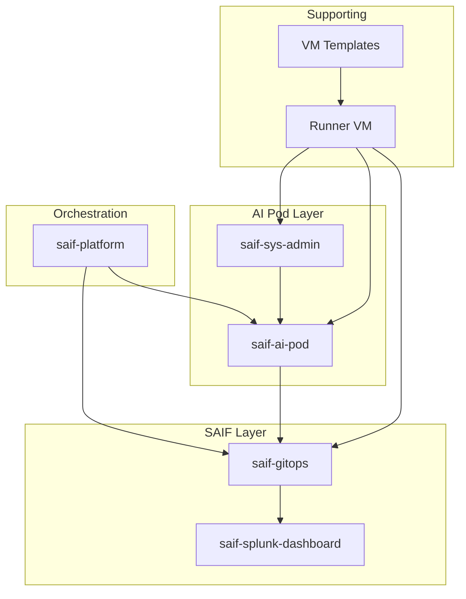

# Repository Map

Complete inventory of all repositories in the SAIF Platform ecosystem.

## Overview

```
┌─────────────────────────────────────────────────────────────────────┐
│                        SAIF Platform 1.0                             │
│                                                                      │
│  Orchestration:     saif-platform                            │
│                                                                      │
│  AI Pod Layer:      saif-ai-pod, saif-sys-admin                 │
│                                                                      │
│  SAIF Layer:        saif-gitops, saif-splunk-dashboard        │
│                                                                      │
│  Supporting:        Runner VM, VM templates (org-specific)        │
└─────────────────────────────────────────────────────────────────────┘
```

## Repository Details

### Orchestration

#### saif-platform

| Attribute | Value |
|-----------|-------|
| **URL** | https://github.com/mahowlin/saif-platform |
| **Layer** | Orchestration |
| **Purpose** | Release coordination, SBOM, cross-repo workflows |
| **Day** | N/A (coordinates all days) |

**Contains:**
- `platform-release.yaml` - Software Bill of Materials (SBOM)
- `orchestrate-release.yaml` - Cross-repo workflow sequencing
- Documentation hub for entire platform

**Workflows:**
| Workflow | Purpose |
|----------|---------|
| `orchestrate-release.yaml` | Full platform deployment |
| `orchestrate-day1.yaml` | Day 1 only (UCS + OCP) |
| `orchestrate-day2.yaml` | Day 2 only (GitOps sync) |

---

### AI Pod Layer (Base Infrastructure)

#### saif-ai-pod

| Attribute | Value |
|-----------|-------|
| **URL** | https://github.com/mahowlin/saif-ai-pod |
| **Layer** | AI Pod |
| **Purpose** | UCS profiles, OpenShift deployment, Cilium Day 1 |
| **Day** | 0 + 1 |

**Contains:**
- `ucs/` - Terraform for Intersight/UCS configuration
- `openshift/` - Cluster configs, templates, Cilium manifests
- `docs/mop/` - Step-by-step procedures
- `mcp/cluster-status/` - MCP tools for cluster access

**Workflows:**
| Workflow | Purpose |
|----------|---------|
| `ucs-pipeline.yaml` | UCS profile lifecycle (plan/stage/activate/delete) |
| `openshift-pipeline.yaml` | Full cluster deployment |
| `openshift-undeploy.yaml` | Cluster teardown |

**Consumes:**
- Mirrored images from `saif-sys-admin`
- IDMS manifests from `saif-sys-admin`

**Produces:**
- Deployed OpenShift clusters
- Kubeconfigs (uploaded to a separate kubeconfig storage repository)

---

#### saif-sys-admin

| Attribute | Value |
|-----------|-------|
| **URL** | https://github.com/mahowlin/saif-sys-admin |
| **Layer** | AI Pod |
| **Purpose** | Image mirroring, IDMS generation, user management |
| **Day** | 0 (infrastructure prep) |

**Contains:**
- `mirror/` - Image lists and mirroring configuration
- User management scripts (HTPasswd, SSH keys)

**Workflows:**
| Workflow | Purpose |
|----------|---------|
| `sync-images.yaml` | Mirror images to internal registry |

**Produces:**
- Mirrored images in `registry.example.com:5000`
- IDMS manifests (consumed by `saif-ai-pod`)
- CatalogSource manifests

---

### Secure AI Factory Layer (Extension)

#### saif-gitops

| Attribute | Value |
|-----------|-------|
| **URL** | https://github.com/mahowlin/saif-gitops |
| **Layer** | SAIF Extension |
| **Purpose** | All Day 2 operators and workloads via ArgoCD |
| **Day** | 2 |

**Contains:**
- `apps/` - ArgoCD Application definitions
- `base/` - Kustomize bases for operators
- `clusters/` - Per-cluster configurations
- `docs/OBSERVABILITY_ARCHITECTURE.md` - Data flow documentation

**Key Applications:**
| Application | Purpose |
|-------------|---------|
| GPU Operator | NVIDIA driver, device plugin |
| NIM Operator | Model inference serving |
| Tetragon | Security observability |
| Hubble Timescape | Flow storage (ClickHouse) |
| Splunk OTEL | Metrics to Splunk Cloud |
| Vector | Flow forwarding |
| Sealed Secrets | GitOps secret management |

**Workflows:**
| Workflow | Purpose |
|----------|---------|
| `sealed-secrets-sync.yaml` | Inject secrets to clusters |

---

#### saif-splunk-dashboard

| Attribute | Value |
|-----------|-------|
| **URL** | https://github.com/mahowlin/saif-splunk-dashboard |
| **Layer** | SAIF Extension |
| **Purpose** | Multi-cluster observability dashboard configuration |
| **Day** | 2 (observability) |

**Contains:**
- `docs/ARCHITECTURE.md` - Dashboard structure
- `docs/EXECUTION_PLAN.md` - Implementation phases

**Note:** Actual CronJob configuration lives in `saif-gitops/apps/splunk-reporter/`

---

### Supporting Infrastructure

#### Runner VM Repository

| Attribute | Value |
|-----------|-------|
| **Layer** | Supporting |
| **Purpose** | GitHub Actions runners, container registry, ISO server |
| **Day** | 0 (infrastructure) |

> **Note:** See your organization's VM deployment and runner configuration repositories. A typical runner VM hosts GitHub Actions runners, a container registry, and a file server for ISO hosting.

**Services:**
| Service | Port | Purpose |
|---------|------|---------|
| GitHub Runners (x3) | N/A | CI/CD execution |
| Container Registry | 5000 | Image storage |
| File Server | 80 | ISO hosting for vMedia |

**CRITICAL:** Single point of failure for all CI/CD.

---

#### Kubeconfig Storage

The post-install workflow pushes kubeconfigs to a separate private repository. Configure `KUBECONFIG_REPO_TOKEN` and the kubeconfig repository URL for your environment.

---

#### VM Template Repository

| Attribute | Value |
|-----------|-------|
| **Layer** | Supporting |
| **Purpose** | VM image automation |
| **Day** | 0 (infrastructure prep) |

> **Note:** See your organization's VM template and Packer configuration repositories. A typical setup uses Packer to build Ubuntu 24.04 LTS templates in vSphere.

---

## Dependency Graph



## Quick Reference

| Need To... | Repository | Workflow/Path |
|------------|------------|---------------|
| Deploy UCS profile | saif-ai-pod | `ucs-pipeline.yaml` |
| Deploy OpenShift cluster | saif-ai-pod | `openshift-pipeline.yaml` |
| Mirror images | saif-sys-admin | `sync-images.yaml` |
| Add new operator | saif-gitops | `apps/` + ArgoCD |
| Fix GitHub runners | Runner VM repo | `ansible/` |
| Check platform versions | saif-platform | `platform-release.yaml` |
