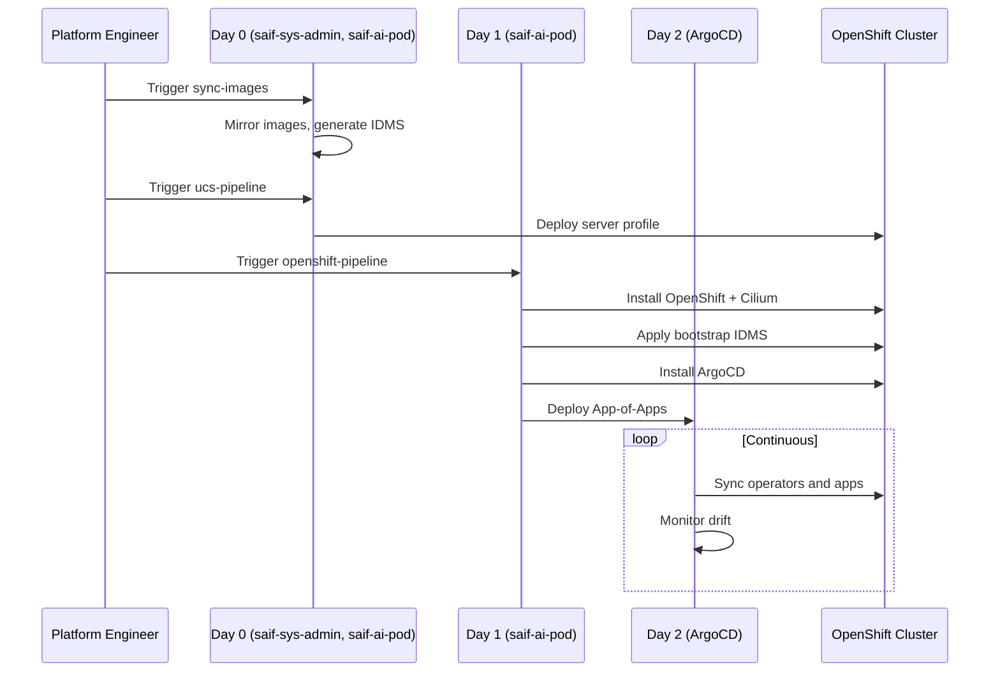

# Day 0 / Day 1 / Day 2 Architecture

## Overview

The SAIF Platform deployment is organized into three phases (Days), each with distinct responsibilities and owners.

```
┌─────────────────────────────────────────────────────────────────────────────┐
│                          DEPLOYMENT TIMELINE                                 │
├─────────────────────────────────────────────────────────────────────────────┤
│                                                                             │
│  DAY 0                    DAY 1                    DAY 2                    │
│  Infrastructure           Cluster Creation         Workload Management      │
│                                                                             │
│  ┌─────────────────┐     ┌─────────────────┐     ┌─────────────────┐       │
│  │ UCS Profiles    │     │ OpenShift       │     │ Operators       │       │
│  │ Image Mirroring │────►│ Installation    │────►│ Applications    │       │
│  │ DNS/Network     │     │ Cilium CNI      │     │ Configs         │       │
│  └─────────────────┘     └─────────────────┘     └─────────────────┘       │
│                                                                             │
│  Owner: Platform Eng     Owner: Platform Eng     Owner: ArgoCD (GitOps)    │
│  Repo: saif-ai-pod     Repo: saif-ai-pod     Repo: saif-gitops  │
│        saif-sys-admin                                                     │
│                                                                             │
│  Duration: Variable      Duration: ~90 min       Duration: Continuous      │
│                                                                             │
└─────────────────────────────────────────────────────────────────────────────┘
```

## Day 0: Infrastructure Preparation

**Purpose:** Prepare all infrastructure before cluster deployment.

**Owner:** Platform Engineering team

**Repositories:**
- `saif-ai-pod` (UCS profiles)
- `saif-sys-admin` (image mirroring)

### Day 0 Tasks

| Task | Workflow | Repository |
|------|----------|------------|
| Mirror container images | `sync-images.yaml` | saif-sys-admin |
| Generate IDMS manifests | `sync-images.yaml` | saif-sys-admin |
| Deploy UCS server profile | `ucs-pipeline.yaml` | saif-ai-pod |
| Configure DNS records | Manual | Infrastructure |
| Verify network connectivity | `validate-prerequisites.yaml` | saif-ai-pod |

### Day 0 Outputs

- Server profile deployed and associated in Intersight
- MAC addresses captured in `cluster-macs.yaml`
- Images mirrored to `registry.example.com:5000`
- IDMS manifests ready for application

---

## Day 1: Cluster Creation

**Purpose:** Deploy OpenShift with minimal configuration, hand off to GitOps quickly.

**Owner:** Platform Engineering team (automated via pipeline)

**Repository:** `saif-ai-pod`

### Day 1 Principle: MINIMALISM

Day 1 should do the **absolute minimum** to get a cluster operational and hand off to Day 2 GitOps.

```
Day 1 Scope (MINIMAL):
├── OpenShift Installation (Agent-Based Installer)
├── Cilium CNI (Day 1 manifests)
├── Bootstrap IDMS (minimal mirrors for ArgoCD)
└── ArgoCD Bootstrap (operator + App-of-Apps)

NOT Day 1 (moved to Day 2):
├── GPU Operator ──────────► GitOps
├── NIM Operator ──────────► GitOps
├── Tetragon ──────────────► GitOps
├── Hubble Timescape ──────► GitOps
├── Splunk OTEL ───────────► GitOps
└── All other operators ───► GitOps
```

### Day 1 Tasks

| Task | Automation | Duration |
|------|------------|----------|
| Generate Agent ISO | `openshift-pipeline.yaml` | ~1 min |
| Upload ISO to file server | `openshift-pipeline.yaml` | ~30 sec |
| Boot server via vMedia | `openshift-pipeline.yaml` | ~1 min |
| OpenShift installation | Agent-Based Installer | ~60-90 min |
| Apply bootstrap IDMS | `openshift-pipeline.yaml` | ~2 min |
| Install ArgoCD operator | `openshift-pipeline.yaml` | ~5 min |
| Deploy App-of-Apps | `openshift-pipeline.yaml` | ~1 min |

### Day 1 Outputs

- Operational OpenShift cluster with Cilium CNI
- ArgoCD installed and syncing from `saif-gitops`
- Kubeconfig uploaded to kubeconfig storage repository

### Why Minimal Day 1?

| Benefit | Explanation |
|---------|-------------|
| **Fast handoff** | Day 2 GitOps takes over in minutes, not hours |
| **Single source of truth** | All config in `saif-gitops` |
| **Easy updates** | Change GitOps repo, not Day 1 pipeline |
| **Idempotent** | Post-install can run multiple times safely |
| **Testable** | Day 2 changes can be tested without redeploying cluster |

---

## Day 2: GitOps Management

**Purpose:** Manage all workloads and configurations via GitOps.

**Owner:** ArgoCD (automated, continuous)

**Repository:** `saif-gitops`

### Day 2 Principle: EVERYTHING IS GITOPS

After Day 1 bootstrap, ALL changes flow through GitOps:

```
saif-gitops/
├── apps/
│   ├── cluster-apps.yaml          # App-of-Apps root
│   ├── platform-idms/             # Full IDMS (sync-wave -10)
│   ├── sealed-secrets-controller/ # Secrets management (sync-wave -8)
│   ├── catalogsources/            # Operator catalogs (sync-wave -1)
│   ├── gpu-operator/              # NVIDIA GPU
│   ├── nfd-operator/              # Node Feature Discovery
│   ├── nim-operator/              # NVIDIA Inference
│   ├── tetragon/                  # Security observability
│   ├── hubble-timescape/          # Flow storage
│   ├── splunk-otel/               # Metrics export
│   └── ...
```

### Day 2 Sync Waves

ArgoCD applies resources in order using sync-waves:

| Wave | Applications | Purpose |
|------|--------------|---------|
| -10 | platform-idms | Full image mirrors |
| -8 | sealed-secrets-controller | Secrets decryption |
| -1 | catalogsources | Operator catalogs |
| 0 | Operators (GPU, NIM, Tetragon) | Core operators |
| 1 | Operator configs (ClusterPolicy, TracingPolicy) | Operator CRs |
| 2+ | Applications | Workloads |

### Day 2 Operations

| Operation | Method |
|-----------|--------|
| Add new operator | Add Application to `saif-gitops` |
| Update operator version | Change subscription channel in GitOps |
| Add new application | Add manifests to GitOps repo |
| Update configuration | Edit GitOps repo, ArgoCD syncs automatically |
| Rollback | Revert commit in GitOps repo |

---

## Boundary Responsibilities

### What Goes Where

| Component | Day | Reason |
|-----------|-----|--------|
| UCS profile | 0 | Hardware config, done once |
| Image mirroring | 0 | Infrastructure prep |
| OpenShift installation | 1 | Cluster bootstrap |
| Cilium CNI | 1 | Required for cluster networking |
| Bootstrap IDMS | 1 | Required for ArgoCD installation |
| ArgoCD bootstrap | 1 | Enables Day 2 GitOps |
| Full IDMS | 2 | Can be updated via GitOps |
| All operators | 2 | Version changes via GitOps |
| All applications | 2 | Continuous deployment |

### Upgrade Paths

| Change Type | Process |
|-------------|---------|
| Operator upgrade | Update GitOps → ArgoCD syncs |
| Platform upgrade (minor) | Update GitOps → ArgoCD syncs |
| OpenShift upgrade | Day 1 pipeline (cluster-impacting) |
| Hardware change | Day 0 UCS pipeline |

---

## Workflow Integration



---

## Related Documentation

- [Platform Architecture](../ARCHITECTURE.md)
- [AI Pod vs SAIF](AI_POD_VS_SAIF.md)
- [saif-ai-pod MOP](https://github.com/mahowlin/saif-ai-pod/blob/main/docs/mop/README.md)
- [saif-gitops](https://github.com/mahowlin/saif-gitops)
