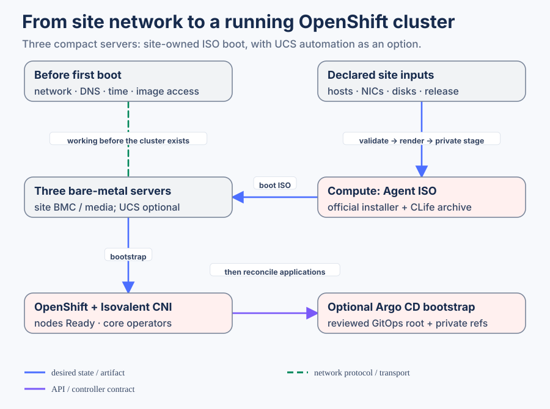

# Install a compact OpenShift cluster

Build one OpenShift cluster on three bare-metal servers with Isovalent CNI from first boot. Each server runs control-plane and application workloads. The portable example uses static IPv4 and two management NICs with common names; UCS, ACI and hosted clusters are separate choices.

## 1. Start with only the inputs you need

[The standalone example](../../examples/standalone/) contains one cluster, a management network, shared service defaults and release selection. Make a site-owned copy. Replace the cluster/base domain, exact NIC MACs, boot disks, node addresses and API/ingress VIPs in its cluster file. Replace subnet, gateway, MTU and VLAN in its network file. The full `data/` profile adds storage, virtualization and hosted-cluster choices; those are not required for this installation.

## 2. Select delivery, trust and release

Use reachable upstream image sources or a prepared site registry. DNS, NTP, entitlement and pull authentication must work before boot. Normal public trust requires no extra CA; private trust requires the actual trusted CA. Select exact OpenShift/Isovalent images and the official CLife archive in the release inputs, keeping their compatibility policy aligned. Changing a tag alone does not qualify another release.

## 3. Render and hash the public artifacts

Validation resolves the declared inputs and fails on missing or conflicting references. Rendering produces five files: install configuration, Agent host configuration, cluster metadata, Cilium configuration and OpenShift network configuration. The generated manifest records their hashes and source identity. These files are reusable configuration, not proof of image access or hardware readiness.

The [executable render procedure](../../agents/installation.md) owns environment setup, exact commands, deterministic comparison and pristine consumer verification. Keep the raw result intact while preparing private executable copies.

## 4. Consumer-local handoff and installation

Compute consumes the same generated bytes, then supplies private pull credentials, SSH key, selected CA and official lifecycle archive. It validates the enriched Agent files before creating the ISO. The site boots the servers through its own BMC/media process. [Compute's installation journey](https://github.com/mahowlin/secure-ai-compute/blob/main/docs/mop/04-openshift-installation.md) explains these stages and readiness checks.

For ACI, first establish [management attachment and tenant routing](FABRIC_NETWORK.md). A site LAN may provide the portable path instead. Neither a specific upstream routing protocol nor UCS discovery is mandatory.

## 5. Hand over to ongoing GitOps operation

Once OpenShift and Isovalent are healthy, optionally register a reviewed GitOps root and select its operator catalog. That root is a site input, not generated by the standalone install. See [Compute post-install](https://github.com/mahowlin/secure-ai-compute/blob/main/docs/POST_INSTALL.md).

## If a local step fails

| Stage | Meaning and response |
|---|---|
| Input validation | Correct canonical values/references; do not patch generated files |
| Hash or private staging check | Recover the pristine render and rebuild the private prepared copy |
| Source image/archive access | Correct entitlement, selected image, auth or trust before ISO/boot |
| Physical boot | Inspect console, actual NIC/disk matching, rendezvous and site services |
| Installed health | Inspect nodes, operators and selected Cilium configuration; a built ISO is insufficient |

The example is source-validated; actual installation, cold image pulls and end-to-end networking require the site's observed evidence.
