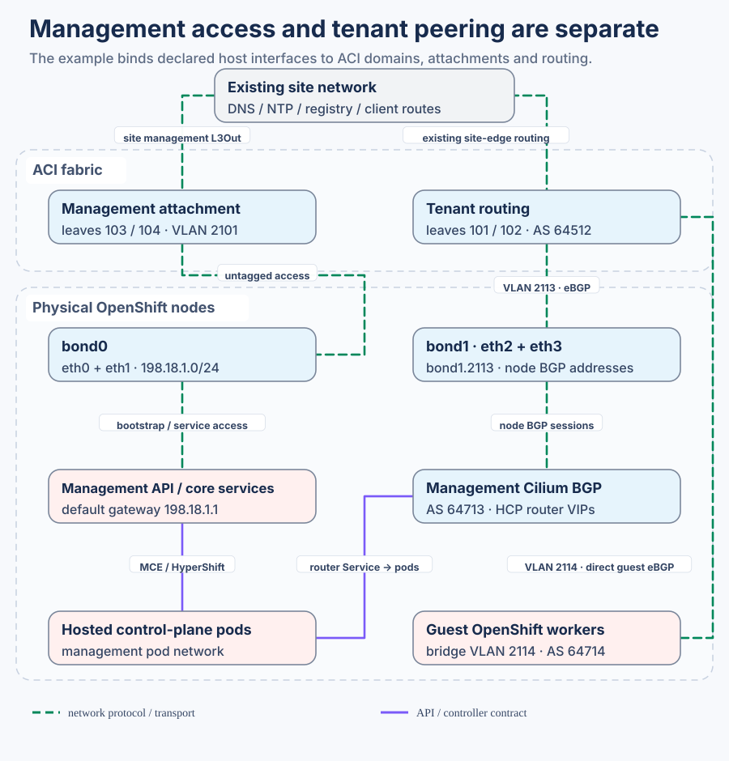

# Fabric and host network handoff

The servers need **management connectivity before OpenShift can start**: node addresses, API/apps VIPs and access to DNS, time and images. Separately, **tenant routing** connects management-hosted control-plane endpoints and guest worker networks to ACI. Tenant BGP does not replace the management network.

## The declared compact example

Start with the [network catalog](../../data/networks/example-federal.yaml) and [management cluster input](../../data/clusters/example-management/cluster.yaml). All names, addresses and ports are synthetic. Change them to your site; do not edit generated YAML.

| What you choose | Where to edit | Result and consumer |
|---|---|---|
| Node subnet, gateway, VLAN, MTU and cluster-facing ACI ports | `managementNetworks.Management`, including `aciAttachment` | Management tenant, access domains/AAEP and physical attachments in Fabric; management bond/address/route in Compute AgentConfig |
| Actual node NICs, MACs, boot disk and management bond | Cluster `agentConfig` and node inventory | Installer host configuration; match actual switch bond/LAG policy |
| Tenant trunk members, peering interfaces and node BGP addresses | Cluster `day2GitOps.parentNetworking` plus selected catalog networks | GitOps NMState bonds/subinterfaces/bridges and Cilium BGP; matching ACI SVI/peers |
| Guest worker VLAN, bridge and routed prefixes | Selected hosted cluster and tenant network references | Host NAD/bridge and direct guest BGP; guest peering is separate from management-node peering |
| DNS, time, registry and trust | [Shared defaults](../../data/defaults/example.yaml) and release/registry selection | Installer and cluster service references; reachable services supplied by the site |

The example's role names make ownership visible: **platform-management** is the management tenant; **tenant-workloads** is the selected tenant-routing domain. `example-management` remains the OpenShift cluster identity. Change each at its canonical input, with references kept coherent.

## Tenant policy and access policy are different files

| Generated Fabric path | Purpose |
|---|---|
| [platform-management/platform-management.yml](../../generated/repos/secure-ai-fabric/data/platform-management/platform-management.yml) | Management VRF, bridge domain, EPG, subnet and static endpoint bindings |
| [access/10-platform-management-domains.yml](../../generated/repos/secure-ai-fabric/data/access/10-platform-management-domains.yml) | Management VLAN pool, physical domain and AAEP |
| [access/30-platform-management-attachments.yml](../../generated/repos/secure-ai-fabric/data/access/30-platform-management-attachments.yml) | Shared management/tenant interface policy groups, port selectors and switch/interface profiles |
| [tenant-workloads/tenant-workloads.yml](../../generated/repos/secure-ai-fabric/data/tenant-workloads/tenant-workloads.yml) | Tenant VRF, floating-SVI BGP L3Out, selected routes, contracts and filters |
| [tenant-workloads/access-policies.yml](../../generated/repos/secure-ai-fabric/data/tenant-workloads/access-policies.yml) | Tenant VLAN pools and physical/routed domain-to-AAEP bindings |

This tenant/shared-access layout keeps the existing NAC model. Import all selected files together: tenant routing references access domains; host configuration references the same VLANs and ports. Optional UCS/FI connectivity requires its own reviewed physical attachments; do not assume the direct-attached example is an FI design.

## What must exist at the site edge

The management bridge domain references a named existing site L3Out and contract. The site provides upstream routes, DNS/time/images, physical commissioning and trusted APIC access. Replace those references with real existing objects or supply them through your site's ACI automation. The example does not configure an unspecified upstream or require OSPF. [Optional endpoint/transit inputs](../../examples/optional-aci-transit/catalog-fragments.yaml) remain separate.

## Validate and render

[AGENTS Fabric execution](../../agents/fabric.md) owns exact validation, rendering, hashing and consumer comparison. Rendering produces the five files above and removes only stale files bearing its own generated marker. Physical-port collisions, missing names or mismatched leaf assignments fail before output. Management attachment requires the selected active-backup design; LACP needs a matching declared port-channel design.

## Hand the same bytes to NAC-ACI

The [Fabric repository](https://github.com/mahowlin/secure-ai-fabric/blob/main/docs/CONFIGURATION.md) consumes these files, or your existing NAC-ACI repository can import them. Review merge ownership where a site already owns shared access policies. The recursive `data/**/*.yml` scan includes every imported file; unrelated examples stay outside it. The handoff procedure creates a dedicated empty generated scan root and verifies its exact inventory, then passes that same root to the site's normal private plan/apply pipeline. It does not overlay a clean checkout and leave obsolete tenant identities behind. Existing NAC projects retain their own reviewed merge/owned-file boundary. Render and Terraform validation do not establish actual links, BGP sessions or reachability.
