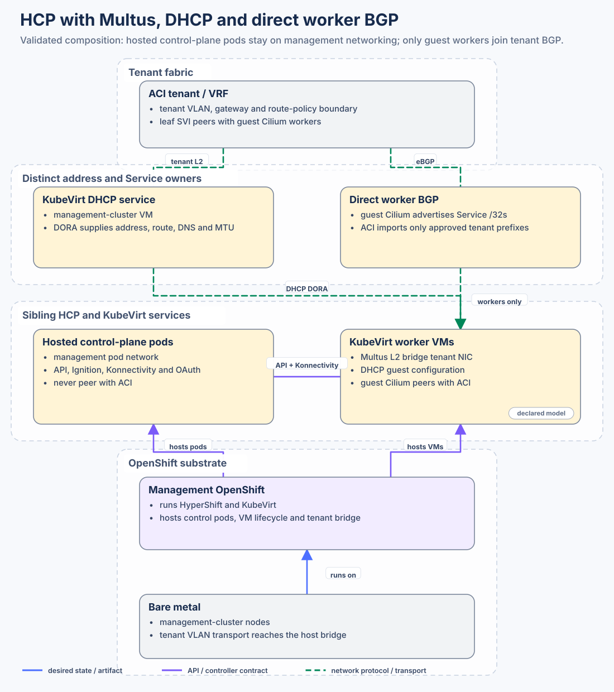
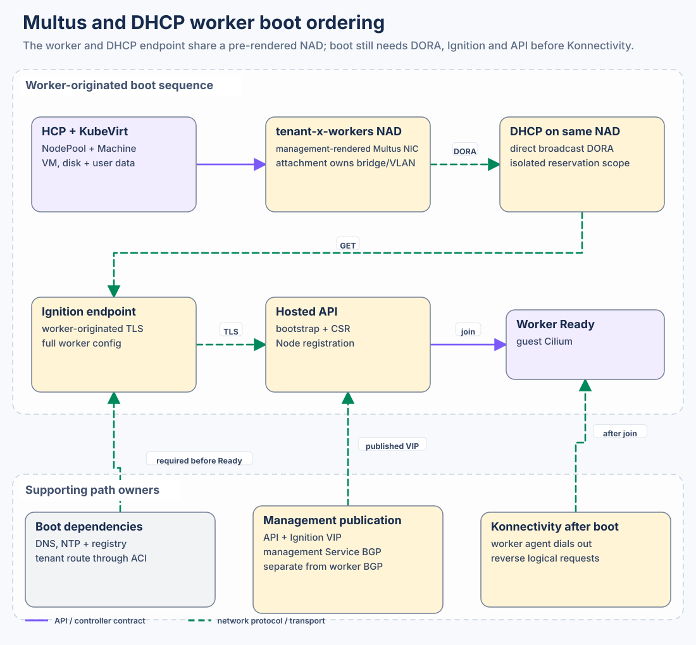
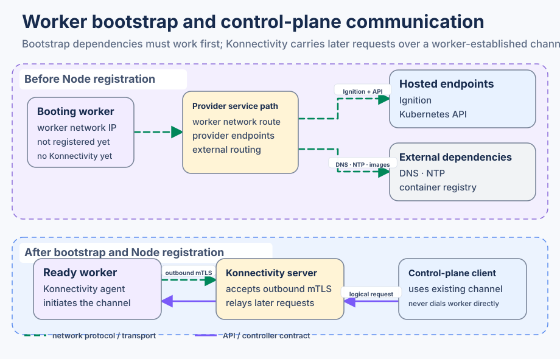

# HCP with Multus, DHCP and direct BGP

A hosted worker here is a virtual machine on the management cluster, whose selected guest network is a single Multus interface on a tenant VLAN (`attachDefaultNetwork: false`). Multus connects that interface through a NetworkAttachmentDefinition, the object that names the bridge the virtual machine joins. The renderer creates the same object for the worker and for the DHCP service, so both sit on one VLAN. DHCP is the only service that assigns the worker address, and the same lease sets the prefix, the default gateway, DNS and the MTU. It does not choose the VLAN or the bridge. Those come from the network catalogue.

Management OpenShift runs the hosted control plane and KubeVirt. Guest Cilium, inside the hosted cluster, advertises application Service addresses to the Cisco ACI tenant. The management cluster publishes the hosted API and Ignition on a separate BGP session. The two sessions do not share a route table.

`example-multus-a` is the cluster that selects this design, and its worker network is `tenant-b-workers`. The network name does not turn BGP on. Direct BGP is a separate choice in the cluster file. The same VLAN attachment can stay east-west only, or send traffic through Isovalent Load Balancer, if you select that instead.

## Building blocks

| Layer | Building blocks | Responsibility |
|---|---|---|
| ACI tenant/VRF | Tenant bridge domain, SVI, L3Out and route policy | Carries the tenant VLAN, provides the guest gateway and peers with guest Cilium workers |
| Management OpenShift | Management pod network, HyperShift, KubeVirt, NMState and management Cilium | Hosts control-plane pods and worker VMs; publishes hosted control services separately |
| Hosted control plane | kube-apiserver, Ignition, Konnectivity and OAuth services | Runs as pods on management networking; never joins guest worker BGP |
| KubeVirt worker | `VirtualMachine`, `virt-launcher`, root disk and Multus NIC | Presents the tenant L2 attachment to the guest and preserves VM lifecycle |
| DHCP service | Management-cluster VM with one interface on this NetworkAttachmentDefinition and a disk that keeps the leases | Supplies the address, prefix, gateway, DNS and MTU through DHCP discover, offer, request and ack |
| Guest OpenShift | Worker nodes, guest Cilium, Services and workloads | Owns application Service selection and direct BGP advertisement |

## Address ownership

The tenant VLAN, subnet, DHCP server address and reservation pool come from the
network catalogue. This profile has one allocator for worker addresses, the
DHCP service, and nothing else in the example hands those addresses out. ACI
owns the tenant gateway and the route off the subnet. Guest Cilium owns its
Service address pool and advertises only the approved Service `/32`s.

Each DHCP interface and pool is bound to one named network. The
`example-shared` network allocates addresses as workers ask for them.

### Retained lease state and cutover boundary

The rendered `example-shared` DHCP service has one 2Gi `ReadWriteOnce` filesystem PVC
(`px-csi-replicated-default`) attached as a virtio disk with the authored serial.
Its guest ext4 filesystem is mounted at `/var/lib/saif-worker-dhcp`, where
`observed-leases.json` holds the validated store. A stable `.authority.lock`
file on that filesystem admits one local DHCP process or initializer at a
time; the process holds its exclusive lock until all serving threads stop.
This guest lock does not fence another VM or replace proof that the old VMI,
socket and storage attachment have stopped. The claim has `Prune=false`;
the VM uses `runStrategy: Manual` and does not live migrate. Keep the same claim
through VM revisions. Do not replace, prune, format or delete a retained claim
during restoration.

The service verifies the disk serial, capacity, filesystem label, mount UUID,
read/write state and existing store before it listens. It never formats a disk
or creates missing state on startup. Every OFFER and ACK follows a serialized,
durable lease commit; an invalid store, changed mount, lost write, corrupt or
incompatible record, or clock rollback stops all serving threads. The service
does not automatically restart after such a fault. A temporary DHCP outage is
the safe behavior while the writer or disk is uncertain.

First provision is an **offline operator step** after the old DHCP writer is
fenced and its VMI, DHCP socket and disk attachment have stopped. Start the new
Manual VM only after that check; its DHCP unit initially fails because state
has not been prepared. A claim's RWO
mode alone is not proof of fencing. Verify the intended namespace, VM, claim,
disk serial, actual guest capacity and storage attachment before running the
guest helper. On a truly blank disk, set
`SAIF_DHCP_INITIALIZE_CONFIRM=hcp-worker-dhcp/saif-worker-dhcp-example-shared:saif-worker-dhcp-example-shared-lease-state`
and run `/usr/local/sbin/saif-worker-dhcp-lease-disk.sh --initialize` once. For
an already formatted, verified disk with no state, use `--prepare-store`; the
helper refuses an existing state in both modes. The serving unit will fail
until the store is explicitly initialized and inspected.

Run `/usr/local/sbin/saif-worker-dhcp-server.py --initialize-store` with one of
these modes and the matching `--confirm-authority` and `--confirm-claim`:

| Mode | Required evidence and flags | Earliest serve time |
|---|---|---|
| `new-scope` | Proven no prior leases in this scope | After the initialized store passes inspection |
| `import` | Complete exported old lease file, measured old-writer stop time, maximum **actually issued** lease seconds, and clock/network margin; pass `--legacy-file`, `--old-fenced-at`, `--max-prior-issued-seconds`, `--clock-network-margin-seconds` | After the validated live records are retained |
| `quarantine` | Proven old writer stopped, measured maximum **actually issued** lease seconds and margin; pass the three timing flags | After `oldFencedAt + maxPriorIssuedSeconds + marginSeconds` |

The authored `leaseSeconds: 300` is not evidence of the maximum previously
issued duration. If the old maximum, old-writer stop time, full export or
single-writer condition is unknown, keep the DHCP service halted and investigate.
Import rejects duplicate or incompatible leases. Quarantine records its end
time in the store and rejects startup until that time. After inspection, start
the unit explicitly with `systemctl start saif-worker-dhcp-server.service` and
verify one writer, one disk and DHCP DORA before any production cutover. This
source contract does not authorize that cutover.

## Worker boot and control sequence

1. HyperShift and the KubeVirt provider reconcile the `HostedCluster`,
   `NodePool`, Machine, VM, root disk and worker user-data objects.
2. Multus connects the worker VM NIC to the tenant bridge before QEMU starts.
3. The guest performs DHCP DORA across that L2 domain and installs its address,
   tenant gateway, DNS and MTU.
4. The worker resolves and retrieves its Ignition configuration through the
   management-hosted publication endpoint.
5. The worker then reaches the hosted kube-apiserver, completes bootstrap and
   registers as a Node.
6. Only after the guest is running can the Konnectivity agent establish its
   outbound mTLS connection. Logical control-plane-to-worker requests then use
   that already-established channel.

Konnectivity is not an Ignition, DNS, NTP, registry or general-egress
substitute. The worker-side agent creates the transport after bootstrap; a
hosted-control-plane client can then send a logical request through the server
over that established channel.

## Management control-service publication

Hosted API, Ignition, Konnectivity and OAuth are services of the hosted control
plane, but their externally reachable VIP is published by the management
cluster. Management Cilium allocates and advertises the router Service `/32`
through the management tenant-facing BGP adjacency. This is not guest worker
BGP and does not advertise the worker subnet.

The selected router VIP and current health must be checked against maintained
input and runtime evidence before a change.

## Direct application Service BGP

The guest cluster's Service, LB-IPAM pool, BGP advertisement and peer policy
select a tenant Service VIP. Guest Cilium workers establish BGP directly over
the tenant VLAN and advertise that `/32` to ACI. ACI imports only permitted
prefixes into the matching tenant VRF.

For an application request, the tenant client routes the Service VIP through
the ACI tenant VRF. ACI forwards the packet to a guest worker advertising that
VIP; Cilium on that worker selects the workload backend. The reply returns from
the backend through the guest worker and ACI tenant VRF to the client. ILB and
management-cluster Egress Gateway do not participate.

## Path ownership summary

| Path | Initiator | First L2/L3 decision | Datapath or translation owner | Return owner | Failure boundary |
|---|---|---|---|---|---|
| DHCP | Worker guest | Multus tenant bridge | DHCP service with retained lease state | Same tenant L2 | No lease means no usable guest network |
| Ignition/API | Worker guest | Guest route through ACI | Management router Service and hosted control service | ACI plus management Service path | DNS, route, TLS or service failure blocks bootstrap |
| Konnectivity | Worker agent transport; control plane logical requests | Worker-established outbound connection | Konnectivity agent/server | Existing tunnel | No established agent means no reverse logical access |
| Same-tenant worker traffic | Worker or workload | Tenant L2/ACI route | Guest Cilium and ACI | Tenant fabric | Policy or routing failure |
| Application ingress | External client | ACI route to advertised Service `/32` | Guest Cilium Service/backend selection | Guest worker and tenant fabric | No advertisement or healthy backend |
| External egress | Worker/workload | Guest default route to ACI | Guest/tenant routing; no management-cluster Egress Gateway | Tenant fabric | No permitted tenant route |

## Evidence boundary

This guide explains the declared example composition. It does not claim that every
current worker, route or service is healthy. Exact runtime results belong in the
[validation notes](../validations/README.md).
Address-lifecycle history and allocator migrations are intentionally excluded
from this implementation guide.
