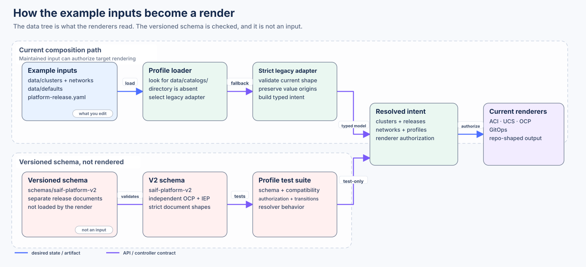

# Schemas

[`saif-platform-v2.schema.json`](saif-platform-v2.schema.json) describes a versioned input shape: separate OpenShift and Isovalent Enterprise Platform releases, compatibility, profiles, authorization gates and cluster selectors. The current example does not use it. Files in [`data/`](../data/README.md) use the shape the renderer loads today, and there is no `data/catalogs/` directory for the versioned documents.

A schema that accepts a document does not authorize a deploy. Change this schema only when you are changing that contract. To change what this repository renders, edit `data/`.

The two paths meet on a typed model. Only the `data/` path is what the renderers read.

`agent-inventory-v1.schema.json` validates the declared third-party compact/SNO hardware shape used by the existing OCP renderer. It does not certify hardware or authorize installation.
